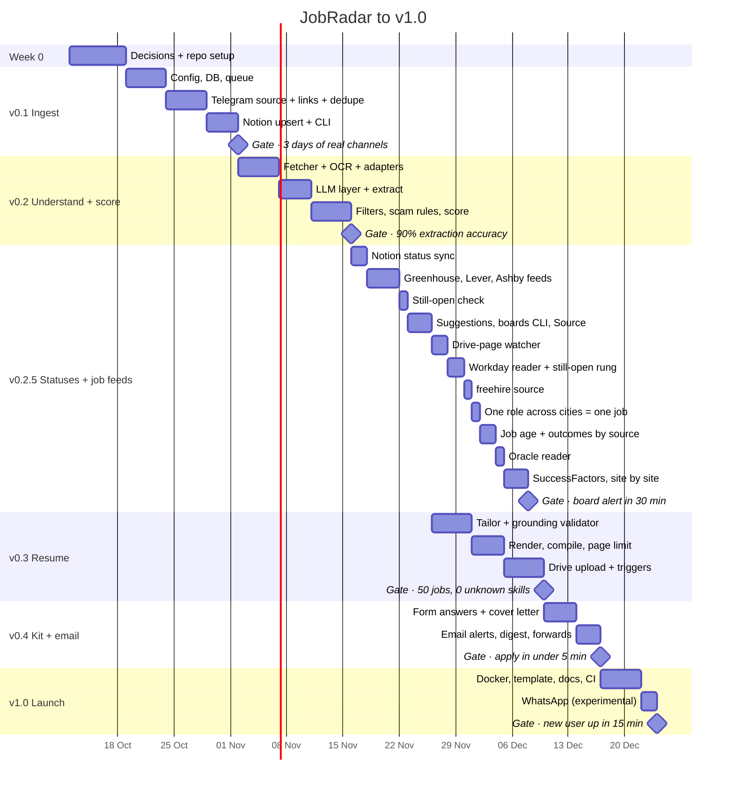
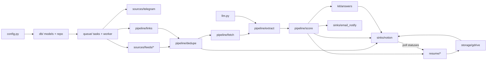

# JobRadar — Implementation Plan

_Created Oct 7, 2026 · targets v1.0 in 8 weeks + a setup week · one developer, part-time_

This plan turns the [PRD](docs/PRD.md), [HLD](docs/HLD.md) and [LLD](docs/LLD.md) into ordered, checkable work. Each release ends with an **exit gate** from the PRD; don't start the next release until the gate passes. File paths match the LLD module layout.

## Timeline

## How the pieces depend on each other

Build bottom-up: config → DB → queue first, because every later module is a task on that queue.

---

## Week 0 — Decisions and repo setup

**Open decisions to close first**

- [x] PyPI distribution name: `jobradar-agent` (`job-radar` is taken). CLI and import name stay `jobradar`.
- [x] Notifications go by email (SMTP), not a Telegram bot; manual adds by forwarding to an email folder.
- [x] Local model: dropped from v1 (Gemini/Groq only); Ollama is a post-v1 idea.
- [x] Drive is required for resumes; `jobradar doctor` reports it when missing.
- [x] Create the GitHub repo (ThePlator/JobRadar) and fill the README clone URL.

**Repo scaffolding**

- [x] `git init`, `.gitignore` (`.env`, `data/`, `output/`, `config/profile.yaml`, `*.session`)
- [x] `LICENSE` (MIT, with copyright holder)
- [x] `pyproject.toml` with uv: Python 3.11+, `src/jobradar` layout, `jobradar` console script (typer)
- [x] Dev tooling: ruff, mypy (strict on `src/`), pytest, pytest-asyncio, pre-commit
- [x] GitHub Actions skeleton: ruff, mypy, pytest, gitleaks
- [x] `.env.example`, `config.example.yaml`, `profile.example.yaml` copied from the LLD
- [x] Create a test Telegram channel and a test Notion workspace for manual runs

**Done when:** `uv run jobradar --help` works and CI is green on an empty test suite.

---

## v0.1 Ingest (MVP) — weeks 1–2

Goal: every job from your channels lands in Notion once, without any AI.

**Foundation**

- [x] `config.py`: `Settings` via pydantic-settings; load YAML + `.env`; fail fast with clear messages
- [x] `db/models.py`: SQLModel tables `source`, `raw_message`, `job`, `job_source`, `artifact`, `task`, `llm_cache` (from the LLD schema)
- [x] `db/repo.py`: all queries in one place; WAL and foreign keys on connect
- [ ] `db/migrations/`: alembic baseline (tables are created with `create_all` until the schema settles)
- [x] `queue/tasks.py`: `enqueue()` (upsert on `(type, key)`), `claim()`, `complete()`, `fail()`
- [x] `queue/worker.py`: async loop, backoff `min(30s·4^(n−1), 1h)` ±20%, `failed` after 5 attempts, reclaim `running` tasks older than 10 min
- [x] `app.py`: wire sources, workers and scheduler; graceful shutdown

**Ingestion**

- [x] `sources/base.py`: `IncomingMessage`, `Source` protocol (entry-point loading comes with the first plugin)
- [x] `sources/telegram.py`: resolve chats → `source` rows; catch-up from `last_msg_id` / `backfill_days`; live `NewMessage` handler; URLs from entities and buttons; photo download when there's no URL; `FloodWaitError` sleep; session file `chmod 600`

**Pipeline**

- [x] `pipeline/links.py`: `canonicalise()` with redirect following (5 hops, 5 s), tracking-param stripping, host denylist, short-link cache
- [x] `pipeline/dedupe.py`: `sha1(canonical_url)` job ids; merge = `job_source` row only. Fingerprint merge is wired in v0.2, once company and role are extracted
- [x] `process_message` task: message → URLs → new or merged job → `notion_upsert`

**Output**

- [x] `sinks/notion.py` write path: find by Job ID, create/update, token bucket at 2.5 req/s, honour 429 `Retry-After`, 2,000-character splitting, agent-owned toggle in the page body
- [x] Start-up Notion schema check that names any missing property
- [x] Build the Notion template database with all properties and the 5 views

**CLI:** `init` (config copy + Telegram login + Notion check), `run`, `chats`, `add <url>`, `retry --failed`

**Tests**

- [x] Unit: `canonicalise()` table (utm, fbclid, www, fragments, trailing slash, short links via respx)
- [x] Unit: queue idempotency, backoff math, stuck-task reclaim
- [x] Integration: fake source → SQLite → mock Notion

**Exit gate:** 3 days of real channels in Notion with under 5% duplicates.

---

## v0.2 Understand and score — weeks 3–4

Goal: every row has structured details and a trustworthy match score.

**Fetching**

- [x] `pipeline/fetch.py`: httpx with 15 s timeout, 1 req/s per-domain semaphore, trafilatura; Playwright fallback under 400 characters; login-wall detection → `None`; SSRF guard (block private, loopback and link-local IPs and `file://`)
- [ ] (part C) `pipeline/adapters/generic.py` and `google_forms.py` (parse `FB_PUBLIC_LOAD_DATA_` into `FormField`s)
- [ ] (part C) `pipeline/ocr.py`: Tesseract for poster images when there's no link

**LLM layer**

- [x] `llm.py`: LiteLLM `structured()` with our own JSON validation + one repair (no instructor dependency); Gemini default, Groq alternative; cache key `sha1(model|prompt_version|input)`; cost logged to `llm_cache.cost_inr`; daily budget pause until midnight IST; one repair retry on schema errors
- [x] `prompts/extract.md` with a `version:` header; untrusted text inside tags
- [x] (part B) `prompts/match.md` (replaced the planned `score.md`): fixed questions answered as levels; the score is computed in code

**Understanding and matching**

- [x] `pipeline/extract.py`: page text (12k-character cap) + message + OCR → `JobPosting`; `confidence < 0.4` with no company or role → `discarded`; schema failure → `needs_review`
- [ ] (part C) Fingerprint dedupe after extraction (30-day window), built as "one role across cities = one job" in v0.2.5 below
- [x] (part B) Free extraction first: page JSON-LD and post labels, Gemini only as fallback (B4a)
- [x] (part B) `pipeline/match.py` + `providers/` (LLM, skills rule) + `pipeline/decide.py` + `pipeline/scam.py` (built instead of `score.py`): hard rules, weighted Match Score, ordered decide policy, scam points, route `hidden` / `new` / alert
- [ ] (part B3) Jev provider, run alongside Gemini first (needs a TypeSafe key)
- [ ] (part B4b) Candidate finders + Jev picks between the free layers and the LLM
- [x] Notion: fill Company, Location, Skills, Experience, Salary, Deadline, Work Mode and the details body
- [x] (part B) Notion: Match Score, Scam Risk and the match reason
- Still-open check moved to v0.2.5, next to the board feeds that share its platform code

**Tests**

- [ ] Collect and hand-label 100 real postings in `tests/fixtures/` (start in week 2; it takes a while)
- [ ] Golden test: per-field accuracy report; runs whenever a prompt version changes
- [ ] Unit: filters, scam rules, fingerprint `norm()`, SSRF guard
- [ ] Recorded HTTP (respx / vcrpy) for fetch; mock LLM for integration

**Exit gate:** over 90% extraction accuracy (role, company, deadline) on the 100 labelled jobs.

---

## v0.2.5 Your statuses and job feeds — before resumes

Goal: JobRadar knows what you did with each job, and sees jobs on company boards minutes after they're posted, before any channel reposts them. Plan with diagrams: [Job feeds](https://claude.ai/artifact/ADfAHymemE5AaMZv1vzre9).

**Notion status sync** (needed by resumes, threshold tuning and the digest)

- [x] `sinks/notion_sync.py` read path: poll the data source every 2 min for pages whose Status the user changed (Shortlisted, Applied, Interview, Offer, Rejected, Skipped, Hidden, New) and mirror it to `job.status` with a `status_change` history; never write Status back except the existing agent hides
- [x] Digest: your applications line (shortlisted, applied, interviews, offers, moves since the last digest); shortlisted jobs already appear under "Closing"
- [x] Alert when a shortlisted job closes within 24 h
- [x] `jobradar stats`: funnel, reply rate, and a `scoring.alert_above` suggestion from the scores of jobs you went for vs skipped
- [x] Tests: status mapping, a page you moved is never re-hidden, cursor overlap, no tight poll loop

**Job feeds: company boards** (public APIs, no keys)

- [x] `sources/boards/`: one reader per hiring system returning one `BoardPosting` shape (built in-tree; entry-point loading comes with the first third-party plugin)
- [x] Greenhouse, Lever (global and EU hosts), Ashby, and SmartRecruiters (India only, experience level) readers
- [x] `feed_board` table: last seen ids and links, postings on the board, passed on, last checked / good read, last error, real 404s in a row, skip-until
- [x] Board check: every `every_minutes` with a per-board spread; first read is a baseline; new postings → filters (India or remote naming no other place, tech title, not senior) → a labelled post through ingest, so the free extraction layer reads it without the LLM
- [x] An error or 404 never means "no jobs": keep the last list; a sudden empty list is ignored. Dead boards: only a real 404 counts as a miss; after 3 misses skip the board and recheck after 30 days. _From career-ops `dead-boards.mjs`._
- [x] Jobs that vanish from their board → hidden "closed on the company board" (only if still untouched in the Inbox)
- [x] Platform detection from a link's host (`greenhouse.io`, `lever.co`, `ashbyhq.com`, `smartrecruiters.com`) in `pipeline/liveness.py`; unknown hosts stay generic. Workday (`myworkdayjobs.com`) comes with its reader. _From career-ops `ats-vendor.mjs`._
- [x] Config `sources.boards` (`enabled`, `every_minutes`, `companies` of `{ats, company, name}`), documented in `config.example.yaml`

**Still-open check** (for links from Telegram too, not only watched boards)

- [x] `pipeline/liveness.py`: before matching (no Gemini call for closed postings), ask the hiring platform whether the posting is still open. Greenhouse, Lever and SmartRecruiters have per-job public APIs (200 = open; Workday later); Ashby has an org board, so check this posting is still listed. Only a 404/410 or a clear closed marker hides the job with reason "posting closed"; timeouts, 429/5xx, redirects and unknown sites mean "unknown" and the job carries on. Requests go only to fixed API hosts, built from path segments of the link with a strict charset, and redirects are refused. No LLM calls. _From career-ops `liveness-api.mjs`._
- [x] Recheck before a Shortlisted job's "closing soon" alert, so you aren't reminded about a job that already closed

**Seeing and managing feeds**

- [ ] Suggestions: count board links seen in Telegram posts per company; `jobradar boards suggest` lists them; nothing is added without the user
- [x] `jobradar boards` (health) and `boards --check`
- [x] `jobradar boards add <ats> <company>` (checks the board exists first), `boards remove`
- [x] Notion **Source** column ("Telegram · Freshershunt", "Greenhouse · Commvault"), added to the database automatically; a view grouped by Source is made in Notion (the API can't create views)
- [x] Emails: "posted 4 min ago on Commvault's Greenhouse board"; digest section "From company boards"
- [x] Starter company list for Indian freshers (career-ops' `portals.example.yml` is mostly US and European companies)
- [ ] Grow it from freehire's `internal/job/collections/indian_roots.txt` (260 companies with Indian roots: IT majors, startups and unicorns, Indian-founder companies abroad): find each company's hiring board from its job links and suggest it through `boards suggest`

**More providers** (same pattern, after the gate)

- [x] SmartRecruiters (pulled forward for Bosch)
- [ ] Recruitee, Workable
- [ ] `sources/search/adzuna.py` (India, free key), optional Jooble: keyword searches in `sources.search`
- Workday moved to "India employer portals" below
- [ ] Remotive and RemoteOK (remote only): respect their limits (Remotive 4 checks a day) and show the required credit and link back

**India employer portals** (where big Indian employers post; plan with diagrams: [India Employer Portals](https://claude.ai/artifact/9Yi3U6ebqMFmeA6EykeoSy)). Check Workday and SuccessFactors field names against one live site before coding each reader.

- [x] Drive-page watcher, first (`sources/pages/`, `watch_page` table): TCS NextStep, Infosys, Wipro Elite NTH and Cognizant GenC publish hiring drives as page announcements, not job lists. Each check: robots.txt gate → fetch through `pipeline/fetch.py` → clean text (drop dates, times and "Posted 3 days ago" counters) → line diff against the saved text → 80+ added characters become an `IncomingMessage` (`platform="page"`, `message_id` from the added text so a restart never reposts). First fetch is a silent baseline.
- [x] What becomes the job: the post carries links found in the added text (made absolute); with no link, it uses the page URL and re-queues extraction for that page's existing job, so a second announcement updates Notion instead of vanishing as a duplicate sighting
- [x] Page states: never checked → watching; 403/429 → back off 2 h, then 4 h; the 3rd in a row → paused and you're told; robots.txt disallow → blocked (both until `pages resume`); a failed DNS lookup or other error is unknown for that round
- [x] Config `sources.pages` (`enabled`, `every_hours` 1–6, `watch` of name → URL), shipped empty; CLI `pages` (`--check`), `pages add` (reads it once, robots.txt obeyed), `pages remove`, `pages resume`
- [x] Workday reader (unofficial search API on the career site; may break): board key `host/Site` from the careers link; find the India filter id once per board (kept in memory); page 20 at a time, 1.5 s apart, up to 15 pages; id from the requisition id, else the job path; posted date from the list's "Posted N Days Ago" (no detail calls); "2 Locations" shown as "India · 2 Locations". 404 → `BoardGone`; 400/403/422/429/5xx, no India filter or a changed response shape → `BoardUnavailable`. Read at most every 30 min whatever `every_minutes` says.
- [x] Workday rung in the still-open check (per-job endpoint), and `myworkdayjobs.com` in platform detection
- [x] `boards add <Workday careers link>` checks the India filter exists before saving
- [ ] `boards suggest` also counts Workday and SuccessFactors links seen in Telegram posts
- [ ] SuccessFactors reader, site by site: sitemap first (`/job_sitemap.xml`, or `/sitemap.xml` as on Wipro: 6,180 job links with city and title in each URL), then RSS, then the India search page; remember which worked per board; new ids get one page fetch (schema.org JobPosting data) for location and description before the filters. A site with none of these goes to the page watcher. Reference implementations: freehire's `internal/ingest/sources/successfactors.go` and career-ops' `providers/successfactors.mjs` (both MIT).
- [ ] Oracle Recruiting Cloud reader (`*.oraclecloud.com`): board `host/CX_n`; the public list address `hcmRestApi/resources/latest/recruitingCEJobRequisitions` with `expand=requisitionList` and the paging offset **inside** the `finder=findReqs;siteNumber=…,limit=…,offset=…,sortBy=POSTING_DATES_DESC` clause (a top-level offset is ignored and re-reads page 1 forever); detail per new job from `recruitingCEJobRequisitionDetails`; job link `hcmUI/CandidateExperience/en/sites/<site>/job/<id>`. Plus an Oracle step in the still-open check and `oraclecloud.com` in platform detection. Reference: freehire's `internal/ingest/sources/oracle.go` (MIT). Read at most every 30 min.
- [x] Rules (pages): robots.txt for every page; pages no more often than hourly; honest `JobRadar/…` user agent; never log in or solve a CAPTCHA; cleaned page text capped at 50,000 characters; nothing watched by default, and the docs say you're responsible for each site's terms
- [x] Page tests: baseline posts nothing; a date-only change posts nothing; an added paragraph with a link posts once and not again after a restart; refusals back off then pause; robots disallow never fetches; a redesign takes a new baseline
- [x] Workday tests (recorded responses): pages, short last page, no India filter, 404, 422, changed response shape, page cap; plus still-open 200/404/410/429/5xx and crafted links
- [x] A read that stops at a reader's page cap (Workday, SmartRecruiters) is partial: nothing is closed, and an unseen posting counts as new only if posted within 3 days (always applied to Workday, whose "Posted N Days Ago" is the real date)

**freehire: one search API for thousands of companies** ([strelov1/freehire](https://github.com/strelov1/freehire), MIT; live at freehire.me)

freehire crawls 92 hiring systems (Workday, Oracle, iCIMS, Taleo, Phenom, SuccessFactors…) and serves them through a public API with no key (600 requests a minute). Checked 2026-10-18: about 4,900 new India postings a day.

- [x] `sources/boards/freehire.py` (its own watcher: a search result that ages out isn't a closed job, so nothing is ever closed): `GET https://freehire.me/api/v1/jobs/search` with `countries=IN`, `seniority=intern,junior`, `open_within_days=2` (reads overlap, nothing missed), `reality_exclude=likely-evergreen`, `sort=created_at`, 100 per page, at most 5 pages per read, every 30 min; at most 20 new per read; each posting keeps the company's own job link (the `utm_source=freehire` tag is stripped by link cleaning, so a job also on a watched board stays one job)
- [x] Config `sources.freehire` (`enabled`, `every_minutes` ≥ 15, `countries`, `seniority`, `categories`, `max_pages`); off by default; Notion Source "freehire · <original source>"; `jobradar freehire` (`--check`); the still-open check runs on freehire jobs (second-hand, unlike a board read)
- [x] Their `countries=IN` also matches Indiana, USA ("Tell City, IN"): JobRadar's own India filter must still run on every posting (it matches whole words, so "Indiana" is already rejected)
- [x] Their category tags are thin (1 backend intern/junior job in a day): fetch broadly and let JobRadar's title filter and matching decide
- [x] It's a third-party service: errors and 429s are "unavailable" (never "no jobs"), honour `x-ratelimit-*` headers, honest user agent; if the API changes, only this source stops
- [x] Tests (recorded responses): a normal page, paging and `max_pages` (well under the 10,000 offset limit), `meta.ignored_params` present (a dropped filter must fail loudly, not return the whole catalogue), 429, an Indiana posting rejected

**One role across cities = one job** (freehire's `jobdedup`: the role fingerprint leaves the location out)

- [ ] After extraction, a job with the same company and role (normalised title) as an open job seen in the last 30 days joins it instead of becoming a new job: one Notion row, locations merged ("Pune · Hyderabad · Chennai"), one alert at most
- [ ] Only when the company is known and the title gives a key; a lookup failure keeps the job separate (dedupe is an improvement, never a reason to lose a job)
- [ ] The older job stays the main one; a job you moved in Notion is never merged into
- [ ] Tests: 10 cities of one Accenture role → one job; different roles at one company stay separate; same title at two companies stays separate

**Job age** (catch old and ghost postings)

- [ ] Keep the company's own publish date when a board reader or the still-open check already calls the platform (Greenhouse, Lever, Ashby, SmartRecruiters, Workday detail); no extra requests
- [ ] Alert says "on the company's board since 2 Sep"; Notion gets a **Posted On** date
- [ ] Posted more than 30 days ago: no instant alert; goes to the digest marked "old posting"
- [ ] Keep "first seen by JobRadar" next to "date the site states": some sites restate an old date on every crawl, so first-seen is the age that can't be rewritten from outside (freehire's `open_within_days` vs `posted_within_days`)
- [ ] Later: possible ghost job. A job from freehire or Telegram whose company board JobRadar watches, but that isn't on that board, is marked "not on the company's board". An unread or empty board means "no coverage", never "missing"; the mark expires after 14 days unless re-checked (freehire's `internal/job/ghost`)

**Tests**

- [x] Recorded responses per provider (respx): normal list, 404 (and Lever's EU fallback), 503, non-JSON
- [x] First-check baseline sends no alerts; a later new posting does; a vanished one is closed
- [x] An error never wipes the last known list; dead-board counting only on real 404s
- [ ] A posting also linked from Telegram stays one job (dedupe by canonical URL)
- [x] Still-open check: recorded responses per platform for open, 404, 410, closed marker, 429, timeout and redirect; only the definite closed cases hide the job; a crafted link can't change the request host

Not possible: LinkedIn, Naukri and Indeed have no public job API and forbid scraping; their jobs keep arriving through Telegram.

**Outcomes: is JobRadar working?** (builds on the `jobradar stats` funnel)

- [ ] `jobradar stats` funnel per source (each Telegram channel, each board, each drive page): jobs, alerts, applied, interviews, offers
- [ ] Alerted vs not: interviews from jobs that sent an alert vs jobs you found in the Inbox or digest
- [ ] Time from post to applied, and from applied to the first reply
- [ ] Digest line once a week: the sources that led to interviews, and the ones with none in 30 days (candidates to mute)

**Exit gate:** a job posted on a watched board reaches your inbox in under 30 minutes, with no alerts from the first check and no false "Closed". A change on a watched drive page reaches your inbox within one check interval, and the logs show no fetch of a robots-disallowed page.

---

## v0.3 Resume — weeks 5–6

Goal: strong matches get a one-page, fully grounded PDF linked from Notion.

- [x] Finalise the `profile.yaml` schema with ids on every experience, project and bullet; validate it at start-up
- [x] `prompts/tailor.md`; `resume/tailor.py` → `TailoredResume` from `writer_model`
- [x] Grounding validator: `ref_id`s exist; skills are a subset of profile skills (case-insensitive + alias map); numbers in rephrased bullets appear in the source bullet; violations dropped and logged
- [x] `resume/render.py`: Jinja2 with `\VAR{}` / `\BLOCK{}` delimiters, `latex_escape()` on every string
- [x] `classic.tex.j2`: the owner's own LaTeX layout, reproduced exactly (`resume.template` may also be a path to your own `.tex.j2`)
- [ ] `modern.tex.j2`
- [x] `resume/compile.py`: `tectonic --untrusted`, 60 s timeout; save `.log` on error; one retry with the plain template
- [x] `resume/validate.py`: pypdf page count; trim the lowest-ranked bullet and recompile up to 3 times
- [x] File naming `{company}_{role}_{yyyymmdd}_v{n}.pdf`
- [x] `storage/local.py` (PDF and .tex in `storage.local_dir`)
- [ ] Later, optional: `storage/gdrive.py`: OAuth installed-app flow, monthly folders, link-sharing off, `webViewLink` → `artifact.drive_url`; refresh failure → keep local + email the owner
- [x] **Triggers:** in `pipeline/decide.py`, `score ≥ auto_resume_above` and `scam_risk != high` → `build_resume` + `build_kit`; the v0.2.5 status sync sees Shortlisted with no resume → `build_resume`
- [x] Notion: Resume = link to the newest local PDF (file://; Drive link once Drive lands); the Status of auto-built jobs stays New
- [x] CLI: `resume <job-id> [--plain] [--template]` (new version), `resume` alone previews your profile
- [ ] `init` adds Google OAuth (with Drive)

**Tests**

- [x] Grounding validator with adversarial cases (invented skill, changed number, unknown `ref_id`)
- [x] More grounding cases, borrowed from career-ops `verify-cv-facts.mjs`: a number inside bold or other markup; size words with no digits ("doubled", "10x", "halved"); a tool name buried in a sentence; a phrase from a configurable banned list; a missing or unreadable `profile.yaml` fails loudly instead of passing
- [x] LaTeX escaping of every special character
- [x] Each template compiles with `profile.example.yaml` across 10 sample jobs, at one page (added to CI)
- [x] Trigger routing: auto threshold, Shortlisted, already-built job not rebuilt

**Exit gate:** one-page PDF and zero unknown skills across 50 jobs.

---

## v0.4 Apply kit and email — week 7

Goal: from a shortlisted job to a submitted form in under 5 minutes.

- [ ] `prompts/kit.md`; `kit/answers.py`: exact matches from `profile.answers` / `basics` first; generated answers otherwise (under 120 words, `[FILL IN: …]` when a fact is missing)
- [ ] Cover letter when the job asks for one or the Cover Letter checkbox is ticked (poller → `build_kit(cover_letter=true)`)
- [ ] Notion body: one code block per form answer, the cover letter, "Seen in" with message links
- [x] `sinks/email_notify.py` (built early, in v0.2 B2): SMTP + STARTTLS to `NOTIFY_TO` only; first alert instant, follow-ups grouped within `alert_batch_minutes`; dry run; shared email template
- [ ] Alerts: resume link once v0.3 lands; `List-Id` header
- [x] Digest email at 09:00 and 19:00 IST: new, top matches, closing in 48 h, hidden, failures, budget status (built early)
- [ ] Digest: auto-built resumes section (with v0.3)
- [ ] `sources/email_forward.py`: IMAP folder poll; accept only your own address with DKIM/SPF pass; body text, links and image attachments → `process_message`
- [ ] Tests against a local SMTP/IMAP test server (e.g. aiosmtpd); `init` sends a test email (`jobradar alerts --test` exists)
- [ ] CLI `doctor` (`stats` landed early, in v0.1, for the duplicate check)

**Exit gate:** timed run — open a shortlisted job, submit the real form, in under 5 minutes.

---

## v1.0 Public open-source launch — week 8

- [ ] `Dockerfile`: Python + Tectonic + Tesseract (+ Playwright Chromium or a separate `browser` service); pre-warm Tectonic packages for `classic`/`modern`
- [ ] `docker-compose.yml`: `jobradar`, `browser`; profile `whatsapp`; volumes `./data`, `./output`, `./config`
- [ ] Publish the Notion template and link it from the README
- [ ] `wa-bridge/` Node sidecar + `sources/whatsapp.py` (local HTTP), off by default, with a ban-risk warning
- [ ] Docs: setup walkthrough with screenshots, Telegram / Notion / Google / Gemini / email app-password guides, troubleshooting, plugin authoring guide (`CONTRIBUTING.md`, `CODE_OF_CONDUCT.md`, `SECURITY.md`, `SUPPORT.md`, `CHANGELOG.md`, issue/PR templates done)
- [ ] CI: Docker build, template compile, gitleaks, Dependabot
- [ ] Release: tag `v1.0.0`, publish the image and the PyPI package `jobradar-agent`
- [ ] Fresh-machine test: someone new follows the README cold

**Exit gate:** a new user is running it in under 15 minutes.

---

## Definition of done (every task)

- Typed (mypy clean), linted (ruff), with tests for the new logic
- Idempotent if it runs as a task; safe to retry
- No secrets in logs; untrusted text only passed to the LLM inside delimiters
- Config options documented in `config.example.yaml`

## Risks to watch during the build

| Risk | Early signal | Response |
|---|---|---|
| Telegram account restriction | `FloodWaitError` frequency rising | Lower catch-up rate; never send from the user account |
| Extraction accuracy stalls below 90% | Golden report after week 3 | Add site adapters; tune `extract.md`; try a stronger `extract_model` |
| Gemini / Groq free-tier limits | 429s in logs | Raise budget, spread load, or switch provider in config |
| Auto-resume volume too high | Digest shows many auto-builds | Raise `auto_resume_above` |
| Alert emails go to spam | Test email not in inbox | Send from your own account to yourself; add a filter on `List-Id: jobradar` |
| Tectonic cold start in Docker | Slow first compile, network errors | Pre-warm the package cache in the image |
| Notion rate limits | 429s during backfill | Rely on the limiter; batch body appends |
| A hiring platform changes its public API | Board errors or "unknown" still-open results jump in `boards list` | Treat as unknown (never closed); fix that provider; recorded-response tests catch the shape change |
| A drive page is redesigned | One page posts a burst of "changes" that aren't jobs | Cap posts per page per check; when most of the text changed at once, take a new silent baseline instead of posting |
| freehire's API changes or goes down | freehire source errors in `jobradar boards` | Treat as unavailable (never "no jobs"); the other sources carry on; fix or switch it off |

## Metrics to verify before v1.0

Duplicate rate under 5% · extraction accuracy over 90% · relevant jobs missed under 5% · apply time under 5 min · resume hallucination 0% · setup time under 15 min.
