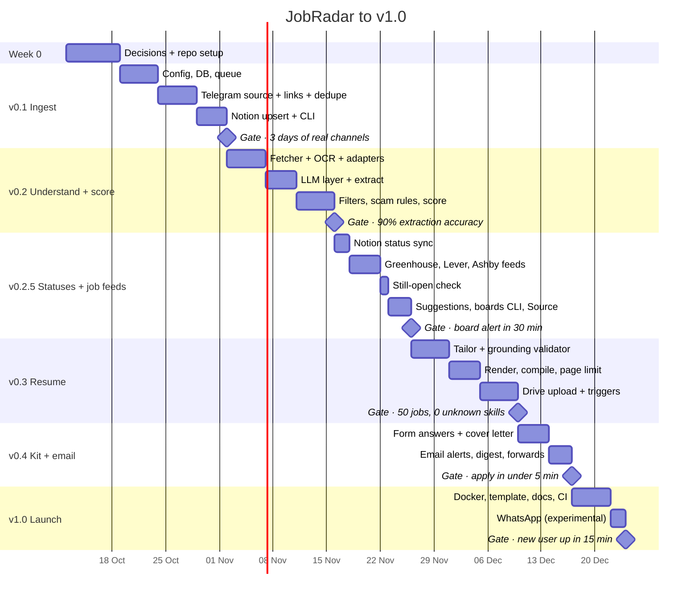
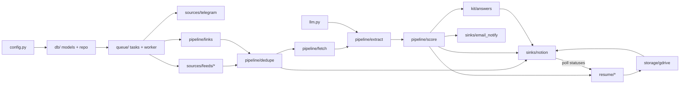

# JobRadar — Implementation Plan

_Created Oct 7, 2026 · targets v1.0 in 8 weeks + a setup week · one developer, part-time_

This plan turns the [PRD](docs/PRD.md), [HLD](docs/HLD.md) and [LLD](docs/LLD.md) into ordered, checkable work. Each release ends with an **exit gate** from the PRD; don't start the next release until the gate passes. File paths match the LLD module layout.

## Timeline

## How the pieces depend on each other

Build bottom-up: config → DB → queue first, because every later module is a task on that queue.

---

## Week 0 — Decisions and repo setup

**Open decisions to close first**

- [x] PyPI distribution name: `jobradar-agent` (`job-radar` is taken). CLI and import name stay `jobradar`.
- [x] Notifications go by email (SMTP), not a Telegram bot; manual adds by forwarding to an email folder.
- [x] Local model: dropped from v1 (Gemini/Groq only); Ollama is a post-v1 idea.
- [x] Drive is required for resumes; `jobradar doctor` reports it when missing.
- [x] Create the GitHub repo (ThePlator/JobRadar) and fill the README clone URL.

**Repo scaffolding**

- [x] `git init`, `.gitignore` (`.env`, `data/`, `output/`, `config/profile.yaml`, `*.session`)
- [x] `LICENSE` (MIT, with copyright holder)
- [x] `pyproject.toml` with uv: Python 3.11+, `src/jobradar` layout, `jobradar` console script (typer)
- [x] Dev tooling: ruff, mypy (strict on `src/`), pytest, pytest-asyncio, pre-commit
- [x] GitHub Actions skeleton: ruff, mypy, pytest, gitleaks
- [x] `.env.example`, `config.example.yaml`, `profile.example.yaml` copied from the LLD
- [x] Create a test Telegram channel and a test Notion workspace for manual runs

**Done when:** `uv run jobradar --help` works and CI is green on an empty test suite.

---

## v0.1 Ingest (MVP) — weeks 1–2

Goal: every job from your channels lands in Notion once, without any AI.

**Foundation**

- [x] `config.py`: `Settings` via pydantic-settings; load YAML + `.env`; fail fast with clear messages
- [x] `db/models.py`: SQLModel tables `source`, `raw_message`, `job`, `job_source`, `artifact`, `task`, `llm_cache` (from the LLD schema)
- [x] `db/repo.py`: all queries in one place; WAL and foreign keys on connect
- [ ] `db/migrations/`: alembic baseline (tables are created with `create_all` until the schema settles)
- [x] `queue/tasks.py`: `enqueue()` (upsert on `(type, key)`), `claim()`, `complete()`, `fail()`
- [x] `queue/worker.py`: async loop, backoff `min(30s·4^(n−1), 1h)` ±20%, `failed` after 5 attempts, reclaim `running` tasks older than 10 min
- [x] `app.py`: wire sources, workers and scheduler; graceful shutdown

**Ingestion**

- [x] `sources/base.py`: `IncomingMessage`, `Source` protocol (entry-point loading comes with the first plugin)
- [x] `sources/telegram.py`: resolve chats → `source` rows; catch-up from `last_msg_id` / `backfill_days`; live `NewMessage` handler; URLs from entities and buttons; photo download when there's no URL; `FloodWaitError` sleep; session file `chmod 600`

**Pipeline**

- [x] `pipeline/links.py`: `canonicalise()` with redirect following (5 hops, 5 s), tracking-param stripping, host denylist, short-link cache
- [x] `pipeline/dedupe.py`: `sha1(canonical_url)` job ids; merge = `job_source` row only. Fingerprint merge is wired in v0.2, once company and role are extracted
- [x] `process_message` task: message → URLs → new or merged job → `notion_upsert`

**Output**

- [x] `sinks/notion.py` write path: find by Job ID, create/update, token bucket at 2.5 req/s, honour 429 `Retry-After`, 2,000-character splitting, agent-owned toggle in the page body
- [x] Start-up Notion schema check that names any missing property
- [x] Build the Notion template database with all properties and the 5 views

**CLI:** `init` (config copy + Telegram login + Notion check), `run`, `chats`, `add <url>`, `retry --failed`

**Tests**

- [x] Unit: `canonicalise()` table (utm, fbclid, www, fragments, trailing slash, short links via respx)
- [x] Unit: queue idempotency, backoff math, stuck-task reclaim
- [x] Integration: fake source → SQLite → mock Notion

**Exit gate:** 3 days of real channels in Notion with under 5% duplicates.

---

## v0.2 Understand and score — weeks 3–4

Goal: every row has structured details and a trustworthy match score.

**Fetching**

- [x] `pipeline/fetch.py`: httpx with 15 s timeout, 1 req/s per-domain semaphore, trafilatura; Playwright fallback under 400 characters; login-wall detection → `None`; SSRF guard (block private, loopback and link-local IPs and `file://`)
- [ ] (part C) `pipeline/adapters/generic.py` and `google_forms.py` (parse `FB_PUBLIC_LOAD_DATA_` into `FormField`s)
- [ ] (part C) `pipeline/ocr.py`: Tesseract for poster images when there's no link

**LLM layer**

- [x] `llm.py`: LiteLLM `structured()` with our own JSON validation + one repair (no instructor dependency); Gemini default, Groq alternative; cache key `sha1(model|prompt_version|input)`; cost logged to `llm_cache.cost_inr`; daily budget pause until midnight IST; one repair retry on schema errors
- [x] `prompts/extract.md` with a `version:` header; untrusted text inside tags
- [x] (part B) `prompts/match.md` (replaced the planned `score.md`): fixed questions answered as levels; the score is computed in code

**Understanding and matching**

- [x] `pipeline/extract.py`: page text (12k-character cap) + message + OCR → `JobPosting`; `confidence < 0.4` with no company or role → `discarded`; schema failure → `needs_review`
- [ ] (part C) Fingerprint dedupe after extraction (30-day window)
- [x] (part B) Free extraction first: page JSON-LD and post labels, Gemini only as fallback (B4a)
- [x] (part B) `pipeline/match.py` + `providers/` (LLM, skills rule) + `pipeline/decide.py` + `pipeline/scam.py` (built instead of `score.py`): hard rules, weighted Match Score, ordered decide policy, scam points, route `hidden` / `new` / alert
- [ ] (part B3) Jev provider, run alongside Gemini first (needs a TypeSafe key)
- [ ] (part B4b) Candidate finders + Jev picks between the free layers and the LLM
- [x] Notion: fill Company, Location, Skills, Experience, Salary, Deadline, Work Mode and the details body
- [x] (part B) Notion: Match Score, Scam Risk and the match reason
- Still-open check moved to v0.2.5, next to the board feeds that share its platform code

**Tests**

- [ ] Collect and hand-label 100 real postings in `tests/fixtures/` (start in week 2; it takes a while)
- [ ] Golden test: per-field accuracy report; runs whenever a prompt version changes
- [ ] Unit: filters, scam rules, fingerprint `norm()`, SSRF guard
- [ ] Recorded HTTP (respx / vcrpy) for fetch; mock LLM for integration

**Exit gate:** over 90% extraction accuracy (role, company, deadline) on the 100 labelled jobs.

---

## v0.2.5 Your statuses and job feeds — before resumes

Goal: JobRadar knows what you did with each job, and sees jobs on company boards minutes after they're posted, before any channel reposts them. Plan with diagrams: [Job feeds](https://claude.ai/artifact/ADfAHymemE5AaMZv1vzre9).

**Notion status sync** (needed by resumes, threshold tuning and the digest)

- [x] `sinks/notion_sync.py` read path: poll the data source every 2 min for pages whose Status the user changed (Shortlisted, Applied, Interview, Offer, Rejected, Skipped, Hidden, New) and mirror it to `job.status` with a `status_change` history; never write Status back except the existing agent hides
- [x] Digest: your applications line (shortlisted, applied, interviews, offers, moves since the last digest); shortlisted jobs already appear under "Closing"
- [ ] Alert when a shortlisted job closes within 24 h
- [x] `jobradar stats`: funnel, reply rate, and a `scoring.alert_above` suggestion from the scores of jobs you went for vs skipped
- [x] Tests: status mapping, a page you moved is never re-hidden, cursor overlap, no tight poll loop

**Job feeds: company boards** (public APIs, no keys)

- [ ] `sources/feeds/base.py`: `Feed` plugin protocol (provider name, poll interval, credit rule) returning one `FeedPosting` shape (title, company, location, url, posted_at, description, source label); loaded through the `jobradar.sources` entry-point group
- [ ] `sources/feeds/greenhouse.py`, `lever.py` (global and EU hosts), `ashby.py`
- [ ] `feed_board` table: provider, company slug, enabled, last checked, last seen ids, consecutive real 404s
- [ ] Board check: every 15–30 min with jitter; **first check records existing jobs without alerting**; new ids → filter (India or remote, target-role words, `intern` / `graduate` / `new grad`) → `process_message`-equivalent with the `FRESH` priority; structured fields skip the LLM extractor
- [ ] An error or 404 never means "no jobs": keep the last list. Dead boards: only a real 404 counts as a miss; after 3 misses skip the board and recheck after 30 days; timeouts, 429s and DNS errors never count. _From career-ops `dead-boards.mjs`._
- [ ] Jobs that vanish from their board → Notion Status "Closed" (only if Status is still New)
- [ ] Platform detection from a link's host (`greenhouse.io`, `lever.co`, `ashbyhq.com`, `myworkdayjobs.com`, …), shared with `pipeline/liveness.py`; unknown hosts stay generic. _From career-ops `ats-vendor.mjs`._
- [ ] Config `sources.boards` (`every_minutes`, `list` of `{ats, company}`), documented in `config.example.yaml`

**Still-open check** (for links from Telegram too, not only watched boards)

- [ ] `pipeline/liveness.py`: before `decide`, ask the hiring platform whether the posting is still open. Greenhouse, Lever and Workday have per-job public APIs (200 = open); Ashby has an org board, so check this posting is still listed. Only a 404/410 or a clear closed marker hides the job with reason "posting closed"; timeouts, 429/5xx, redirects and unknown sites mean "unknown" and the job carries on. Requests go only to fixed API hosts, built from path segments of the link with a strict charset, and redirects are refused. No LLM calls. _From career-ops `liveness-api.mjs`._
- [ ] Recheck before a Shortlisted job's "closing soon" alert, so you aren't reminded about a job that already closed

**Seeing and managing feeds**

- [ ] Suggestions: count board links seen in Telegram posts per company; `jobradar boards suggest` lists them; nothing is added without the user
- [ ] `jobradar boards add <ats> <company>` (checks the board exists first), `boards list` (last check, jobs found, new today, errors), `boards remove`
- [ ] Notion **Source** column ("Telegram · Freshershunt", "Greenhouse · Commvault") and a view per source
- [ ] Emails: "posted 4 min ago on Commvault's Greenhouse board"; digest section "From company boards"
- [ ] Starter company list for Indian freshers (career-ops' `portals.example.yml` is mostly US and European companies)

**More providers** (same pattern, after the gate)

- [ ] SmartRecruiters, Recruitee, Workable
- [ ] `sources/search/adzuna.py` (India, free key), optional Jooble: keyword searches in `sources.search`
- [ ] Workday (unofficial `cxs` endpoint; may break)
- [ ] Remotive and RemoteOK (remote only): respect their limits (Remotive 4 checks a day) and show the required credit and link back

**Tests**

- [ ] Recorded responses per provider (respx): normal list, empty list, 404, 429, timeout, malformed JSON
- [ ] First-check baseline sends no alerts; a later new posting does; a vanished one is marked Closed
- [ ] An error never wipes the last known list; dead-board counting only on real 404s
- [ ] A posting also linked from Telegram stays one job (dedupe by canonical URL)
- [ ] Still-open check: recorded responses per platform for open, 404, 410, closed marker, 429, timeout and redirect; only the definite closed cases hide the job; a crafted link can't change the request host

Not possible: LinkedIn, Naukri and Indeed have no public job API and forbid scraping; their jobs keep arriving through Telegram.

**Exit gate:** a job posted on a watched board reaches your inbox in under 30 minutes, with no alerts from the first check and no false "Closed".

---

## v0.3 Resume — weeks 5–6

Goal: strong matches get a one-page, fully grounded PDF linked from Notion.

- [ ] Finalise the `profile.yaml` schema with ids on every experience, project and bullet; validate it at start-up
- [ ] `prompts/tailor.md`; `resume/tailor.py` → `TailoredResume` from `writer_model`
- [ ] Grounding validator: `ref_id`s exist; skills are a subset of profile skills (case-insensitive + alias map); numbers in rephrased bullets appear in the source bullet; violations dropped and logged
- [ ] `resume/render.py`: Jinja2 with `\VAR{}` / `\BLOCK{}` delimiters, `latex_escape()` on every string
- [ ] `templates/classic.tex.j2` and `modern.tex.j2`
- [ ] `resume/compile.py`: `tectonic --untrusted`, 60 s timeout; save `.log` on error; one retry with the plain template
- [ ] `resume/validate.py`: pypdf page count; trim the lowest-ranked bullet and recompile up to 3 times
- [ ] File naming `{company}_{role}_{yyyymmdd}_v{n}.pdf`
- [ ] `storage/local.py`; `storage/gdrive.py`: OAuth installed-app flow, monthly folders, link-sharing off, `webViewLink` → `artifact.drive_url`; refresh failure → keep local + email the owner
- [ ] **Triggers:** in `pipeline/decide.py`, `score ≥ auto_resume_above` and `scam_risk != high` → `build_resume` + `build_kit`; the v0.2.5 status sync sees Shortlisted with no resume → `build_resume`
- [ ] Notion: Resume = Drive link; the Status of auto-built jobs stays New
- [ ] CLI: `resume <job-id> [--template]` (new version), `init` adds Google OAuth

**Tests**

- [ ] Grounding validator with adversarial cases (invented skill, changed number, unknown `ref_id`)
- [ ] More grounding cases, borrowed from career-ops `verify-cv-facts.mjs`: a number inside bold or other markup; size words with no digits ("doubled", "10x", "halved"); a tool name buried in a sentence; a phrase from a configurable banned list; a missing or unreadable `profile.yaml` fails loudly instead of passing
- [ ] LaTeX escaping of every special character
- [ ] Each template compiles with `profile.example.yaml` across 10 sample jobs, at one page (added to CI)
- [ ] Trigger routing: auto threshold, Shortlisted, already-built job not rebuilt

**Exit gate:** one-page PDF and zero unknown skills across 50 jobs.

---

## v0.4 Apply kit and email — week 7

Goal: from a shortlisted job to a submitted form in under 5 minutes.

- [ ] `prompts/kit.md`; `kit/answers.py`: exact matches from `profile.answers` / `basics` first; generated answers otherwise (under 120 words, `[FILL IN: …]` when a fact is missing)
- [ ] Cover letter when the job asks for one or the Cover Letter checkbox is ticked (poller → `build_kit(cover_letter=true)`)
- [ ] Notion body: one code block per form answer, the cover letter, "Seen in" with message links
- [x] `sinks/email_notify.py` (built early, in v0.2 B2): SMTP + STARTTLS to `NOTIFY_TO` only; first alert instant, follow-ups grouped within `alert_batch_minutes`; dry run; shared email template
- [ ] Alerts: resume link once v0.3 lands; `List-Id` header
- [x] Digest email at 09:00 and 19:00 IST: new, top matches, closing in 48 h, hidden, failures, budget status (built early)
- [ ] Digest: auto-built resumes section (with v0.3)
- [ ] `sources/email_forward.py`: IMAP folder poll; accept only your own address with DKIM/SPF pass; body text, links and image attachments → `process_message`
- [ ] Tests against a local SMTP/IMAP test server (e.g. aiosmtpd); `init` sends a test email (`jobradar alerts --test` exists)
- [ ] CLI `doctor` (`stats` landed early, in v0.1, for the duplicate check)

**Exit gate:** timed run — open a shortlisted job, submit the real form, in under 5 minutes.

---

## v1.0 Public open-source launch — week 8

- [ ] `Dockerfile`: Python + Tectonic + Tesseract (+ Playwright Chromium or a separate `browser` service); pre-warm Tectonic packages for `classic`/`modern`
- [ ] `docker-compose.yml`: `jobradar`, `browser`; profile `whatsapp`; volumes `./data`, `./output`, `./config`
- [ ] Publish the Notion template and link it from the README
- [ ] `wa-bridge/` Node sidecar + `sources/whatsapp.py` (local HTTP), off by default, with a ban-risk warning
- [ ] Docs: setup walkthrough with screenshots, Telegram / Notion / Google / Gemini / email app-password guides, troubleshooting, plugin authoring guide (`CONTRIBUTING.md`, `CODE_OF_CONDUCT.md`, `SECURITY.md`, `SUPPORT.md`, `CHANGELOG.md`, issue/PR templates done)
- [ ] CI: Docker build, template compile, gitleaks, Dependabot
- [ ] Release: tag `v1.0.0`, publish the image and the PyPI package `jobradar-agent`
- [ ] Fresh-machine test: someone new follows the README cold

**Exit gate:** a new user is running it in under 15 minutes.

---

## Definition of done (every task)

- Typed (mypy clean), linted (ruff), with tests for the new logic
- Idempotent if it runs as a task; safe to retry
- No secrets in logs; untrusted text only passed to the LLM inside delimiters
- Config options documented in `config.example.yaml`

## Risks to watch during the build

| Risk | Early signal | Response |
|---|---|---|
| Telegram account restriction | `FloodWaitError` frequency rising | Lower catch-up rate; never send from the user account |
| Extraction accuracy stalls below 90% | Golden report after week 3 | Add site adapters; tune `extract.md`; try a stronger `extract_model` |
| Gemini / Groq free-tier limits | 429s in logs | Raise budget, spread load, or switch provider in config |
| Auto-resume volume too high | Digest shows many auto-builds | Raise `auto_resume_above` |
| Alert emails go to spam | Test email not in inbox | Send from your own account to yourself; add a filter on `List-Id: jobradar` |
| Tectonic cold start in Docker | Slow first compile, network errors | Pre-warm the package cache in the image |
| Notion rate limits | 429s during backfill | Rely on the limiter; batch body appends |
| A hiring platform changes its public API | Board errors or "unknown" still-open results jump in `boards list` | Treat as unknown (never closed); fix that provider; recorded-response tests catch the shape change |

## Metrics to verify before v1.0

Duplicate rate under 5% · extraction accuracy over 90% · relevant jobs missed under 5% · apply time under 5 min · resume hallucination 0% · setup time under 15 min.
