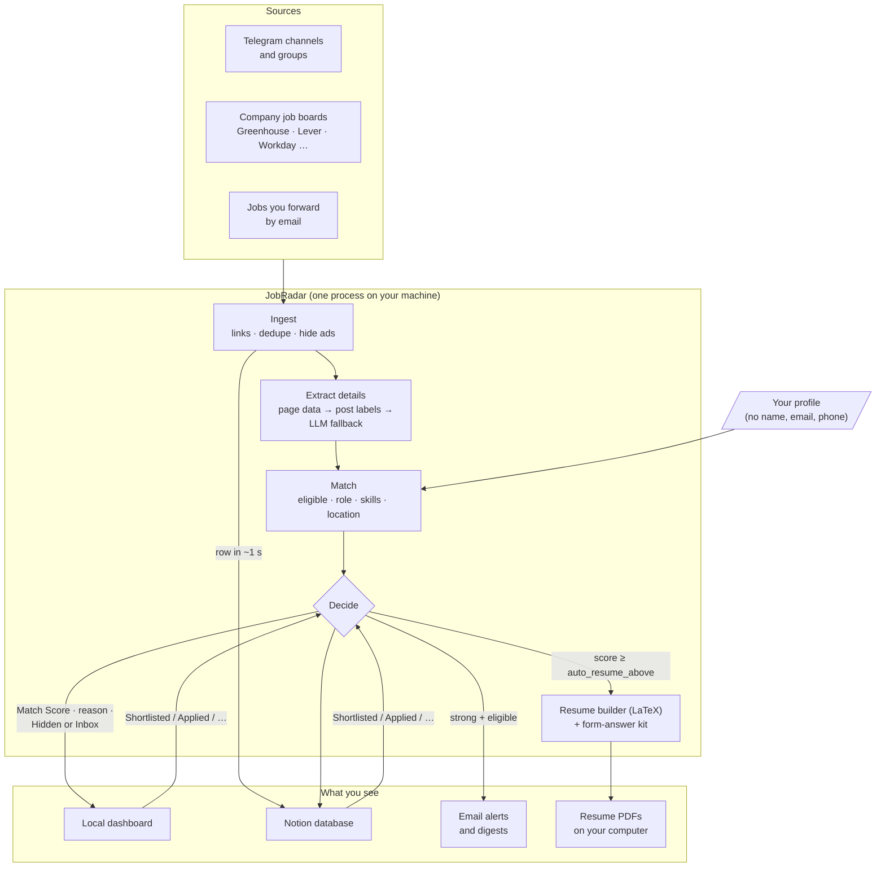

# JobRadar

**One inbox for every new job from company career pages, job boards and the Telegram groups you follow: deduplicated, ranked, and ready to apply.**

**Website:** [jobradar.theplator.dev](https://jobradar.theplator.dev/), see how it works and try the post reader in your browser.

JobRadar is an open-source, self-hosted agent. It reads company career sites directly (Greenhouse, Lever, Ashby, SmartRecruiters, Workday and Oracle boards, plus freehire.me's search across about 90 hiring systems), watches hiring-drive pages and your Telegram job channels, and takes jobs you forward by email. It reads each job page, pulls out each job's details (free rules first, an LLM only when needed), scores how well each job fits your profile, emails you only about strong matches you're eligible for, builds a tailored one-page LaTeX resume, and lays everything out on a local dashboard and in Notion. You review and click Submit; JobRadar never applies for you.

> **Status:** pre-1.0, and I use it every day for my own job search. Working today: company boards, hiring-drive pages, Telegram and email-forward sources, dedupe, ad and scam filtering, free extraction with a Gemini fallback, the Match Score, email alerts and digests, tailored resumes, follow-up reminders, replies from companies, and a local dashboard. Not done yet: a one-command Docker setup, [Jev](https://typesafe.ai/blog/introducing-system-one-models-and-jev) matching, and running without Notion. See the [roadmap](#roadmap).

---

## Why

Job hunting means checking dozens of company career pages every day, and if you are a fresher in India, also 10 to 50 Telegram and WhatsApp groups that post hundreds of links a day. Most of those links are duplicates, irrelevant, or scams. Good postings get missed or found days late, deadlines pass, and every application needs a resume tweak and the same form answers typed again.

JobRadar fixes that:

- **Straight from the source.** The company boards you pick are read through their public job APIs every 20 to 30 minutes, so a new posting reaches you minutes after it goes up, not when someone reposts it. `jobradar boards add <careers link>` adds one. Hiring-drive pages are checked every few hours (robots.txt obeyed).
- **And from the groups.** Telegram channels are watched in real time, with backfill on first run, and you can forward any job by email.
- **One job, one row.** A job posted in 10 groups, or one role posted for three cities, shows up once, with a "Seen In" count.
- **Ranked by fit.** Each job is checked against your profile: are you eligible, is it a role you want, do your skills cover it, does the location work. Code turns the answers into a 0–100 Match Score with a reason: *Good fit · 82 · eligible ✓ · Python, SQL ✓ · missing Docker · Remote ✓*.
- **Free first.** Most details come from the job page's structured data and the post's own "Company: … Role: …" lines. An LLM is only called when those fall short: 138 of the first 181 Telegram jobs needed no AI call at all.
- **Scams flagged.** Registration fees, personal-email-only HR and unrealistic pay raise a Scam Risk flag. A likely scam is never emailed.
- **Tailored resumes that only say true things.** Strong matches get a one-page PDF built only from facts in your profile. A checker undoes any rewrite that adds a number, tool or claim your profile doesn't have.
- **Alerts you can trust.** An email only when a job is a strong match, you're eligible, it's fresh and it isn't a likely scam. One email per job, a daily cap, a morning and evening digest, and closing-deadline reminders.
- **After you apply.** Tap **I applied** in an email or on the dashboard. JobRadar drafts a follow-up after 10 quiet days and spots interview invites, tests and rejections in your inbox (it suggests the status change; it never makes it on its own).

## How it works



1. **Ingest:** new board postings, page changes and channel messages are saved to a local SQLite queue before anything else happens, so nothing is lost on a restart. Links are expanded and cleaned, duplicates merged, channel ads hidden. The job appears in Notion within a second.
2. **Extract:** the job page is fetched, and details are filled cheapest first: structured data on the page, the post's own labels, then an LLM only if role or company is still missing. Board postings that aren't in India, aren't tech or are senior are skipped before any AI call.
3. **Match:** one LLM request per job answers eligibility, role fit, skills coverage, seniority and location, each with a confidence. Code combines them with your weights into a Match Score and a reason line. Without an LLM key, a skills-overlap rule scores instead (and never alerts).
4. **Decide:** confidently ineligible jobs are hidden with the reason; likely scams are flagged and never emailed; uncertain matches go to the Inbox marked "unsure"; strong, eligible, fresh matches also send an email. The first alert goes out about 30 seconds after the job is matched.
5. **Build and apply:** strong matches (or any job you set to **Shortlisted**) get a tailored resume and form answers. Open the job, read the reason, open the resume, copy the answers, submit.

## Where you see your jobs

**Dashboard.** `jobradar run` also serves a page at http://127.0.0.1:8080, read from JobRadar's own database: **Today** (good matches from the last 3 days you haven't acted on, with filters and search), **Applications** (a drag-and-drop board from Shortlisted to Offer, with follow-up timers), **All jobs**, the **Digest**, and a page per job (how the score was made, which skills you have or lack, resumes, the follow-up draft). Buttons change a status and Notion follows. It only listens on 127.0.0.1 and refuses requests from other sites.

**Email.** Alerts, digests and reminders have **I applied** and **Not interested** buttons that work from your phone's mail app.

**Notion.** Each job is also one page in a Notion database. JobRadar adds any columns it needs on start.

| Property | What it shows |
|---|---|
| Role, Company, Location, Work Mode | Extracted from the posting |
| Match Score | 0–100 fit against your profile |
| Status | New → Shortlisted → Applied → Interview → Offer (plus Rejected, Skipped, Hidden) |
| Deadline, Posted On | Application deadline and publish date, if stated |
| Skills, Experience, Salary | Extracted requirements |
| Apply Link | Canonical application URL |
| Resume | Link to the newest tailored PDF on your computer |
| Seen In | How many of your groups posted it |
| Source | Where it was seen: "Telegram · Freshershunt", "Greenhouse · Stripe" |
| Scam Risk | Low / Medium / High |

Anything you write outside the agent-owned "JobRadar" toggle on a page is never overwritten.

## Quick start

**You need:** Python 3.11+ and [uv](https://docs.astral.sh/uv/), a Telegram account, a Notion account, a Gmail account (for alerts, with an app password), and a free [Gemini](https://aistudio.google.com/) or [Groq](https://console.groq.com/) API key. For resume PDFs, also [Tectonic](https://tectonic-typesetting.github.io/) or `texlive-latex-extra`.

```bash
git clone https://github.com/ThePlator/JobRadar.git
```

```bash
cd JobRadar && cp .env.example .env && uv sync --extra web
```

Fill in `.env` (see [Configuration](#configuration)), then run first-time setup. It copies the example configs into `config/`, logs in to Telegram (a code arrives in your Telegram app; nothing is posted) and checks your Notion database:

```bash
uv run jobradar init
```

Edit `config/config.yaml` and `config/profile.yaml`. `uv run jobradar chats` lists the Telegram chats you can read, with the ids to paste in. Then start it:

```bash
uv run jobradar run
```

Telegram API keys are needed to start for now, even if you only want company boards; making each source optional is on the roadmap. Alerts start in **dry run**: they're saved to `data/alerts/` instead of sent, so you can check them for a few days before turning email on. To keep it running after you close the terminal, see [docs/COMMANDS.md](docs/COMMANDS.md#start-stop-restart). A Docker image is planned for v1.0.

## Configuration

JobRadar uses three files. All are validated at start-up, and a bad value stops the app with a clear message.

### `.env`: secrets only, never committed

| Variable | Where to get it |
|---|---|
| `TG_API_ID`, `TG_API_HASH` | [my.telegram.org](https://my.telegram.org) → API development tools |
| `EMAIL_ADDRESS`, `EMAIL_APP_PASSWORD` | Your email and an app password ([Gmail](https://myaccount.google.com/apppasswords)); used to send alerts and read your own button replies |
| `NOTIFY_TO` | Where alerts and digests go (defaults to `EMAIL_ADDRESS`) |
| `NOTION_TOKEN`, `NOTION_DATABASE_ID` | A Notion internal integration, shared with your database |
| `GEMINI_API_KEY` or `GROQ_API_KEY` | Google AI Studio or Groq console: extraction fallback, matching and resume tailoring. Without one, jobs are read from page data and post labels only and scored by the skills rule |

### `config.yaml`: what to watch and how to filter

```yaml
sources:
  telegram:
    chats: ["@offcampusjobs", "@freshersjobs", -1001234567890]
    backfill_days: 3
  boards:
    greenhouse: {Stripe: stripe}
    lever: {Meesho: meesho}
    workday: {NVIDIA: nvidia.wd5.myworkdayjobs.com/NVIDIAExternalCareerSite}

llm:
  extract_model: "gemini/gemini-flash-lite-latest"
  extract_mode: fallback    # LLM only when page data and post labels miss role or company
  writer_model: "gemini/gemini-flash-latest"
  daily_budget_inr: 15

filters:
  batch_years: [2025, 2026]
  degrees: ["B.Tech", "BE", "MCA"]
  locations: ["Bengaluru", "Hyderabad", "Pune", "Remote"]
  max_experience_years: 1

scoring:
  hide_below: 40          # confident matches below this → Hidden
  alert_above: 75         # at or above, and confident and eligible → email alert
  auto_resume_above: 85   # at or above → resume built automatically (null = only on Shortlisted)

matching:
  providers: [llm, skills_rule]   # tried in order
  weights: {skills_coverage: 0.40, role_alignment: 0.30, seniority_fit: 0.15, location_ok: 0.15}
  min_confidence: 0.5     # below this: marked "unsure", never emailed
  branch_strict: false    # true: "CSE/IT only" jobs count as not eligible
```

Changing `weights` re-ranks your jobs from stored answers at the next start, with no new model calls. Editing `profile.yaml` or `filters` matches open jobs again. `jobradar boards add <link>` adds a company board after checking it exists. [config.example.yaml](config.example.yaml) lists every setting.

### `profile.yaml`: the only source of resume facts

Your education, skills, experience, projects (each bullet with an `id` and tags) and reusable form answers such as notice period and expected CTC. The resume builder can choose, order and rephrase your bullets to match a job's wording, but it can't add skills, tools, numbers or claims that aren't in this file.

## CLI

Every command with examples, log reading, settings and fixes: [docs/COMMANDS.md](docs/COMMANDS.md).

| Command | What it does |
|---|---|
| `jobradar init` | Copy example configs, Telegram login, Notion schema check |
| `jobradar run` | Start sources, workers, scheduler and the dashboard |
| `jobradar web` | Only the dashboard |
| `jobradar chats` | List Telegram chats you can read, with ids |
| `jobradar add <url>` | Process one link manually |
| `jobradar boards [add <link> \| remove <name> \| --check]` | Company boards you watch, their health and newest posting |
| `jobradar resume <job-id>` | Build a resume now (`jobradar resume` alone previews your profile) |
| `jobradar digest --now` | Send the digest for the current window right away |
| `jobradar alerts --test` | Send yourself one test email to check that alerts reach you |
| `jobradar followups [--now]` | Applied jobs and when their follow-up draft is due |
| `jobradar skills` | Skills your good matches ask for that your profile lacks |
| `jobradar stats [--days 7]` | Posts, jobs, reposts merged, hidden ads, your funnel, failed tasks |
| `jobradar retry --failed` | Re-queue failed tasks |

You can also add jobs by forwarding any email, message text or link to your JobRadar mail folder (for Gmail: a `JobRadar` label with a filter).

## Privacy and safety

- **Runs on your machine.** Your profile, keys, Telegram session, database and PDFs stay local. The dashboard listens only on 127.0.0.1.
- **Minimal data to providers.** Matching and resume tailoring send your LLM provider the job text and a compact profile (education, skills, experience, preferences), never your name, email or phone. Extraction sends only job text.
- **Email stays narrow.** JobRadar uses an app password and emails only you. From your inbox it reads only its own button emails (signed, and only from your address) and new mail from companies you applied to.
- **Read-only on Telegram.** JobRadar reads with your account, only the chats you list. It never sends messages, joins groups or messages recruiters.
- **You submit every application.** No auto-apply and no scraping behind logins. Company boards are read through their public job APIs; watched pages obey robots.txt.
- **Prompt-injection aware.** Job pages are passed to the LLM as delimited data, outputs are schema-validated, and the model has no tools.
- **Guard your session file.** `data/tg.session` gives full access to your Telegram account. It is `chmod 600` and git-ignored; never share it.

> You are responsible for following the terms of service of every platform you connect. The WhatsApp source uses an unofficial client that can get a number banned; it is experimental, off by default, and a spare number is strongly recommended.

## Cost

Most details come from free rules, and dedupe runs before any model call. With Gemini's free tier my own use costs nothing; at list prices an LLM call is about ₹0.10 (≈ $0.001) per job with flash-lite. Answers are cached, and a daily budget cap (`llm.daily_budget_inr`) pauses model work when reached.

## Roadmap

| Release | Scope | State |
|---|---|---|
| **v0.1 Ingest** | Telegram listener, link cleanup, dedupe, ad filtering, SQLite queue, one Notion row per job | ✓ |
| **v0.2 Read and match** | Page reading, free extraction, Match Score, decide step, scam flags, email alerts, digests | ✓ |
| **v0.2.5 Statuses and feeds** | Statuses from Notion and email buttons, company boards, still-open check, closing reminders | ✓ |
| **v0.3 Resume** | profile.yaml, LaTeX templates, grounding checker, check as hiring software reads it, auto + Shortlisted triggers | ✓ |
| **v0.4 Apply kit** | Form answers, cover letter, forward-to-add, follow-ups, replies from companies | ✓ |
| **v0.5 Dashboard** | Local web dashboard; Notion and Telegram become optional | in progress |
| **Matching with Jev** | [Jev](https://typesafe.ai/blog/introducing-system-one-models-and-jev) answers the match questions with calibrated confidence, beside the LLM first | planned |
| **Text-only posts** | Posts without links, poster OCR | planned |
| **v1.0 Public release** | Docker image, PyPI (`jobradar-agent`), setup guide; WhatsApp as experimental | planned: new user running in under 15 minutes |

## Documentation

- [Commands](docs/COMMANDS.md): every command, logs, settings and fixes
- [Product Requirements (PRD)](docs/PRD.md): goals, user stories, requirements, metrics, risks
- [High-Level Design (HLD)](docs/HLD.md): architecture, flows, integrations, deployment, security
- [Low-Level Design (LLD)](docs/LLD.md): schema, models, module specs, prompts, Notion mapping, plugins

## Tech stack

Python 3.11+ (asyncio) · Telethon · httpx · trafilatura · LiteLLM + instructor (Gemini or Groq) · SQLite + SQLModel (with full-text search) · FastAPI · Jinja2 · Tectonic / pdfLaTeX · aiosmtplib + imap-tools · Notion API · uv

## Contributing

JobRadar is split into sources, site adapters, storage and sinks, so adding one doesn't touch the core. Discovering them as Python entry points (so a plugin can live in its own package) is planned for v1.0:

| Extension point | Built in | Ideas |
|---|---|---|
| `jobradar.sources` | telegram, boards, pages, email_forward, whatsapp (experimental) | Job-alert emails, RSS, Discord |
| `jobradar.site_adapters` | generic, google_forms | More hiring-site pages |
| `jobradar.storage` | local | Google Drive, S3 |
| `jobradar.sinks` | notion, email_notify | Telegram bot, Slack, Google Sheets |

Resume templates are plain `.tex.j2` files. CI runs ruff, mypy, pytest (660+ tests), gitleaks and a Docker build on every change.

Issues and pull requests are welcome. Start with [CONTRIBUTING.md](CONTRIBUTING.md), and please follow the [Code of Conduct](CODE_OF_CONDUCT.md). Changes are listed in [CHANGELOG.md](CHANGELOG.md); for help, see [SUPPORT.md](SUPPORT.md).

## Security

Found a vulnerability? Please report it privately, not in a public issue. See [SECURITY.md](SECURITY.md) for how, what's in scope, and what to do if a secret leaks.

## License

[MIT](LICENSE)
