# JobRadar SaaS: the complete plan

_Written 2026-10-24 · branch `saas/main` · status: planned, nothing built yet_

This document is the single source of truth for turning JobRadar from a single-user, self-hosted
agent into a multi-user SaaS. It says **what** we will build, **how**, **in what order**, and
**why** each choice was made (and why the alternatives were not). It is written so that a new
developer, a new user, or another AI agent can read it cold and continue the work.

If something here conflicts with a later decision, update this file in the same PR as the
decision. Never let the code and this plan disagree silently.

---

## Contents

1. [Summary](#1-summary)
2. [Words used in this plan](#2-words-used-in-this-plan)
3. [Where JobRadar is today](#3-where-jobradar-is-today)
4. [Goals and non-goals](#4-goals-and-non-goals)
5. [Two products, two branches](#5-two-products-two-branches)
6. [Target architecture](#6-target-architecture)
7. [Decisions: what we use, and what we don't, and why](#7-decisions-what-we-use-and-what-we-dont-and-why)
8. [Data model](#8-data-model)
9. [Keeping users apart](#9-keeping-users-apart)
10. [Sign-in and access](#10-sign-in-and-access)
11. [The job pipeline for many users](#11-the-job-pipeline-for-many-users)
12. [Task queue and workers](#12-task-queue-and-workers)
13. [Live updates (SSE)](#13-live-updates-sse)
14. [The REST API](#14-the-rest-api)
15. [Pages (server-rendered)](#15-pages-server-rendered)
16. [Email, files and resumes](#16-email-files-and-resumes)
17. [Plans, quotas and costs](#17-plans-quotas-and-costs)
18. [Security and privacy](#18-security-and-privacy)
19. [Operations: hosting, backups, monitoring](#19-operations-hosting-backups-monitoring)
20. [Moving the owner's existing data](#20-moving-the-owners-existing-data)
21. [The pull requests, one by one](#21-the-pull-requests-one-by-one)
22. [Testing strategy](#22-testing-strategy)
23. [Risks and how we handle them](#23-risks-and-how-we-handle-them)
24. [Open questions](#24-open-questions)
25. [Rules for anyone working on this branch](#25-rules-for-anyone-working-on-this-branch)

---

## 1. Summary

- JobRadar finds jobs (company boards, hiring pages, Telegram channels), understands them, scores
  them against a person's profile, alerts on strong matches, builds tailored one-page resumes, and
  tracks applications on a dashboard. Today it serves **one person on one computer**.
- The SaaS lets **many people sign up** and get all of that for themselves, from servers we run.
- **One shared Postgres database** for everyone. Every per-user row has a `user_id`. Postgres
  row-level security (RLS) makes the database itself refuse other users' rows.
- **Firebase Authentication** for sign-in (Google and email link). Firebase only knows *who*
  someone is; their data stays in our database.
- **Public jobs are processed once for everyone** (shared catalog). Only matching, statuses,
  alerts and resumes are per user. This is what keeps costs flat as users grow.
- **REST API** under `/api/v1` (FastAPI, OpenAPI), **server-rendered pages** (Jinja), **live
  updates with SSE** (server-sent events).
- All SaaS work happens on the long-lived **`saas/main`** branch. `main` stays the open-source,
  single-user, SQLite app. Code flows `main` → `saas/main` only.
- **17 pull requests** to a private beta, in the order in [section 21](#21-the-pull-requests-one-by-one).

---

## 2. Words used in this plan

| Word | Meaning |
|---|---|
| **User** | A person with a JobRadar SaaS account. |
| **Owner** | Sameer, who built JobRadar and runs the SaaS. Also user #1. |
| **Catalog** | The shared tables of public job postings, pages and extraction results. Identical for every user. |
| **Per-user data** | Everything that belongs to one user: profile, preferences, matches, statuses, alerts, resumes. Always has a `user_id`. |
| **Fan-out** | The step that takes one new catalog job and decides which users it could fit. |
| **Match** | One user's score and verdict for one job. |
| **Task** | A unit of background work in the queue (fetch a page, match a job for a user, build a resume). |
| **Outbox** | A table of events written in the same transaction as the change they describe; the source of live updates. |
| **RLS** | Postgres row-level security: rules inside the database that filter rows by the current user. |
| **Service layer** | `jobradar/services/`: the only code that reads or writes data. Pages, API and CLI call it. |
| **Self-hosted app** | JobRadar on `main`: one user, SQLite, runs on their own computer. |
| **SSE** | Server-sent events: a long-lived HTTP response the server writes events to. |

---

## 3. Where JobRadar is today

On `main` (October 2026), JobRadar is complete for one user: releases v0.1 to v0.5 are done
(ingest, extraction, scoring, alerts, resumes, apply kit, dashboard). See `AGENTS.md` and
`PLAN.md`.

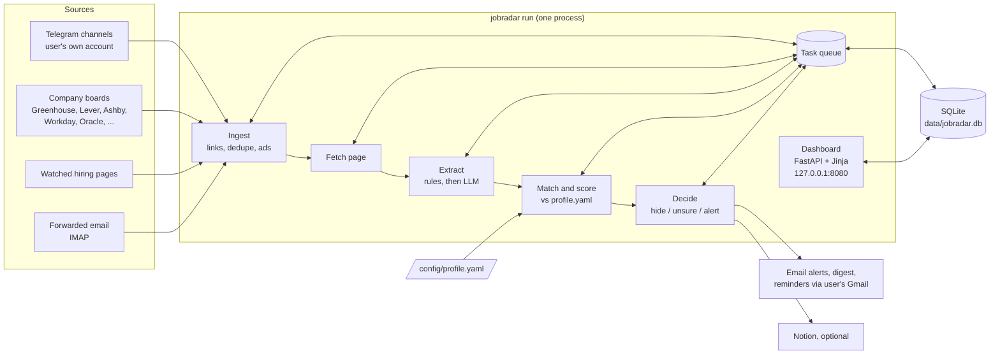

What makes it single-user today (all of this changes in the SaaS):

| Today | Why it can't serve many users |
|---|---|
| `job.score`, `job.status`, `job.score_reason` live on the shared `job` row | One job has one score and one status. With many users, each user needs their own. |
| `config/profile.yaml` and `config/config.yaml` on disk | One profile, one set of filters. |
| Telegram read with the user's own account (`data/tg.session`) | We can't hold every user's Telegram login. |
| Email sent through the user's Gmail app password; buttons read back over IMAP | We can't hold every user's mailbox password. |
| SQLite, one writer at a time; `PRAGMA` settings, FTS5 search, a few SQLite-only SQL queries (`repo.py` has 36 SQLite-specific spots) | Many users writing at once need a server database. |
| Dashboard binds 127.0.0.1, page token per install | Must be on the internet with real accounts. |
| LLM key and daily budget are the user's own | Needs a platform key with per-user limits. |
| Resume PDFs in a local folder | Needs private per-user storage. |
| The task queue has no idea of users | One user's 50 resume builds would block everyone. |

What we **keep**: the pipeline logic (ingest, fetch, extract, match, decide), the board readers,
the scoring rules, the resume builder and its grounding check, the status rules, the
"misclick within 10 minutes" rule, the dashboard's look and pages, and almost all tests.

---

## 4. Goals and non-goals

**Goals**

1. Anyone can sign up with Google or email and get their own JobRadar within 5 minutes:
   import a resume, set preferences, start receiving matches.
2. Every user sees only their own data, enforced in code **and** in the database.
3. Public job sources are read and understood **once**, however many users there are.
4. The system stays cheap: LLM calls grow with *jobs that fit someone*, not with
   *users x jobs*.
5. A REST API that the pages, a phone, scripts and a future React app can all use.
6. Live updates on open pages without reloading.
7. Ready for 100,000 users without changing the architecture; one server is enough for the beta.
8. India's DPDP Act (Digital Personal Data Protection Act, 2023) respected from day one:
   notice, consent, export, deletion.

**Non-goals (for the first release)**

- Applying to jobs on a user's behalf. JobRadar never applies; the user always submits.
- Reading users' inboxes (company replies). Needs Google's restricted-scope review; later.
- Notion sync. The dashboard replaces it in the SaaS.
- Teams, recruiters, or shared workspaces. One account = one job seeker.
- A native mobile app. The site works on phones; an app can come later on the same API.
- Billing. Comes after the beta proves people use it.
- Changing the self-hosted app on `main` into anything else.

---

## 5. Two products, two branches

| | Self-hosted (`main`) | SaaS (`saas/main`) |
|---|---|---|
| Users | One | Many |
| Database | SQLite | Postgres |
| Sign-in | None (127.0.0.1 + page token) | Firebase |
| Runs on | The user's computer | Our servers |
| License | MIT, open source | Same code base, plus SaaS code on its own branch |

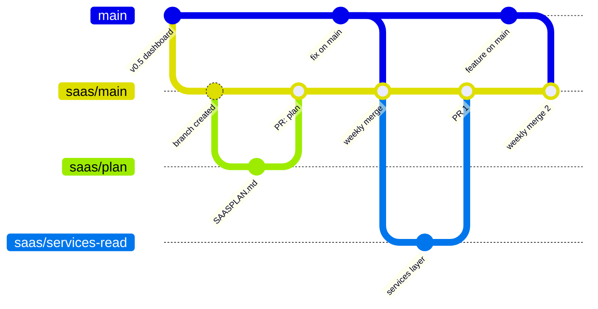

**Rules**

1. `saas/main` is the integration branch for the SaaS. It is never merged into `main`.
2. Every SaaS change is a short branch `saas/<topic>` (for example `saas/auth`) with a pull
   request **into `saas/main`**, never into `main`.
3. Bug fixes and features that both products need are made on `main` first (normal PRs), then
   reach the SaaS through the weekly merge `main` → `saas/main`.
4. Conflicts from the weekly merge are fixed on the `saas/main` side, in a PR named
   `saas/sync-<date>`.
5. Code that only makes sense for the SaaS (Firebase, Postgres, tenants, quotas) never goes to
   `main`.

**Why a separate branch and not a flag in `main`?** The SaaS changes the database engine, adds
sign-in, splits tables per user and adds infrastructure. Behind a flag, every self-hosted user
would carry that weight and risk, and every PR on `main` would have to keep both modes working.
A branch keeps the open-source app simple and lets the SaaS move fast.

**Why not a separate repository?** The two share almost all pipeline code. In one repository the
weekly merge brings every fix across with git's help; in two repositories we would copy patches
by hand.

---

## 6. Target architecture

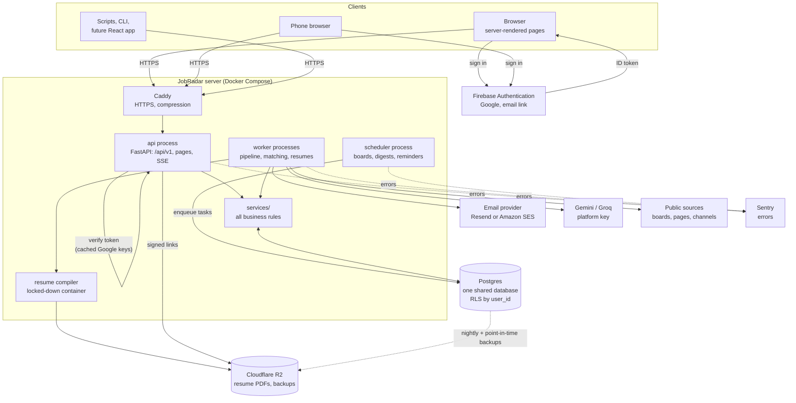

**How a request moves**

1. The browser signs in with Firebase and receives an ID token.
2. It exchanges the token once for a secure session cookie (`POST /api/v1/session`).
3. Every later request carries the cookie (pages) or a bearer token (scripts, apps).
4. The `api` process checks it, finds the user, opens a database transaction and sets
   `app.user_id` for RLS.
5. The route calls one function in `services/`, which reads or writes only through the
   repository layer.
6. Changes write an outbox row in the same transaction; the SSE stream sends it to that user's
   open pages.
7. Slow work (resume build, adding a link, sending a digest) becomes a task; the API answers
   `202 Accepted` at once and a worker does the work.

**Processes**

| Process | What it does | Scales by |
|---|---|---|
| `api` | HTTP: pages, `/api/v1`, SSE streams. Never calls the LLM or job sites. | More copies behind Caddy. |
| `worker` | Runs tasks: ingest, fetch, extract, fan-out, match, alerts, resume builds. The only process that calls outside services. | More copies; tasks are claimed safely with `SKIP LOCKED`. |
| `scheduler` | Wakes up every minute and enqueues due work: board checks, page checks, digests, reminders, follow-ups. Enqueues only, does no work itself. | One copy (a database lock prevents two). |
| `postgres` | The database. Managed (Neon, Supabase or RDS) or a container for local work. | Bigger instance, then read replicas. |

---

## 7. Decisions: what we use, and what we don't, and why

Each decision lists the choice, the alternatives we looked at, and the reasons. Reopen one only
with a new reason, and record the change here.

### 7.1 Database: one shared Postgres database

**Chosen:** one Postgres database for all users. Every per-user table has `user_id`. Postgres
RLS as a second lock.

| Option | Verdict | Why |
|---|---|---|
| **Shared Postgres, `user_id` + RLS** | **Chosen** | Many writers at once; RLS makes isolation a database guarantee; one schema to migrate; cross-user queries (fan-out, admin, analytics) are single queries; managed backups and replicas; the standard way to build a SaaS. |
| Shared SQLite with `user_id` | Rejected for the SaaS | One writer at a time limits busy hours; no RLS; one server only. Fine for the self-hosted app (`main` keeps it). |
| One SQLite file per user | Rejected | 100,000 users = 100,000 files to migrate, back up and monitor; fan-out would open thousands of files per job; cross-user queries impossible; moving to a server database later would be a large project. Its only advantage (isolation) is covered by RLS. |
| One Postgres schema per user | Rejected | Same migration and fan-out problems as files per user, inside one server. |
| One Postgres database per user | Rejected | Expensive, slow to create, impossible to query across users. |
| MongoDB / other document stores | Rejected | Our data is relational (users, jobs, matches, statuses, history); SQL joins and constraints fit it; the codebase is already SQLModel/SQLAlchemy. |

### 7.2 Postgres from the first data PR, not later

**Chosen:** move the SaaS branch to Postgres in PR 3, before sign-in and before any user data
exists.

**Why now:** there is nothing to migrate yet, so the switch is a code change, not a live data
migration. Everything written afterwards (users, `user_id`, tokens, quotas, catalog, fan-out) is
written once for Postgres. RLS is designed in, not bolted on. Later, a migration would need
copying every user's rows, checking them, downtime and a way back.

**Why not stay on SQLite for the beta:** it would save a few days now and cost weeks later, plus
risk during a live migration with real users.

**Cost of the choice:** local development needs a Postgres container (one `docker compose up`),
and the weekly merge from `main` may conflict in `db/repo.py` where SQL differs. We keep
SQL portable (SQLAlchemy constructs) wherever possible to keep those conflicts small.

### 7.3 Sign-in: Firebase Authentication

| Option | Verdict | Why |
|---|---|---|
| **Firebase Authentication** | **Chosen** | Google sign-in is what students in India already use; email-link sign-in for others; generous free tier for Google and email sign-in (SMS codes are billed); ID tokens are JWTs we verify on our server with Google's public keys (cached), so no network call per request; Firebase holds identity only, our data stays in our database; mature Python admin SDK (`firebase-admin`) for session cookies and revocation. |
| Supabase Auth | Good alternative | Pairs naturally with Supabase Postgres; also JWT based. We keep it as the fallback if we host Postgres on Supabase. Slightly smaller ecosystem for Google sign-in UX on Android. |
| Clerk | Rejected for now | Best ready-made sign-in screens, but the price grows faster with users, and it is more product than we need. |
| Auth0 | Rejected | Built for enterprise SSO; costs more than we need at our scale. |
| Build our own (passwords, OAuth) | Rejected | Password storage, resets, Google OAuth, abuse protection and 2FA are a large security surface we don't need to own. |

**How we keep Firebase replaceable:** the rest of the code only sees our own `users.id`. The
Firebase uid is one column (`users.auth_uid`) and token checks live in one module
(`saas/auth.py`). Switching providers means changing that module and mapping uids, not the app.

### 7.4 API style: REST with OpenAPI

| Option | Verdict | Why |
|---|---|---|
| **REST, JSON, OpenAPI** | **Chosen** | FastAPI generates OpenAPI for free; easy from phones, scripts and curl; caches and proxies understand it; our data has a clear resource shape (jobs, statuses, resumes). |
| GraphQL | Rejected | Flexible queries we don't need; harder to cache, rate-limit and secure per field; more moving parts. |
| gRPC | Rejected | Great between services, poor from browsers; we have one backend. |

### 7.5 Pages: keep server-rendered pages

| Option | Verdict | Why |
|---|---|---|
| **Server-rendered Jinja pages + small vanilla JS** | **Chosen** | The dashboard already exists and looks right; fast on cheap phones; no Node build; landing and job pages can be indexed by search engines; each page calls the same services as the API. |
| React single-page app now | Later, maybe | Would mean rebuilding every page before launch. The API makes it possible later without server changes. |
| htmx | Optional | Could be added for partial updates; not required, since SSE + small JS already cover live updates. |

### 7.6 Live updates: SSE

| Option | Verdict | Why |
|---|---|---|
| **Server-sent events (SSE)** | **Chosen** | Updates only flow server → user (new job, scored, status changed, resume ready). Plain HTTP: works through Caddy, proxies and mobile networks; browsers reconnect automatically and resume with `Last-Event-ID`. |
| WebSocket | Rejected | Two-way channel we don't need; more connection handling and proxy setup. Only worth it for chat-like features. |
| Polling | Rejected | Slower and wasteful (today's resume-build page polls; SSE replaces it). |

### 7.7 Task queue: keep our own queue, in Postgres

| Option | Verdict | Why |
|---|---|---|
| **Our existing durable queue, moved to Postgres, claimed with `FOR UPDATE SKIP LOCKED`** | **Chosen** | Already built and tested (retries, backoff, priorities, stuck-task recovery); tasks commit in the same transaction as the data that caused them, so nothing is lost or duplicated; no extra server. `SKIP LOCKED` lets many workers claim tasks safely. |
| Celery + Redis / RabbitMQ | Rejected | Another server to run; tasks and data in different systems can disagree after a crash. |
| RQ, Dramatiq, Arq | Rejected | Same reason: an extra broker for no gain at our size. |
| Cloud queues (SQS, Pub/Sub) | Later, maybe | If we outgrow Postgres as a queue (very high volume). The queue module is one place to swap. |

### 7.8 Search: Postgres full-text search

| Option | Verdict | Why |
|---|---|---|
| **Postgres full-text search (`tsvector`, GIN index, `ts_headline` for snippets)** | **Chosen** | In the same database, transactional, no extra service; replaces SQLite FTS5 one for one (ranking, snippets, prefix search). |
| Meilisearch / Typesense | Later, maybe | Better typo tolerance; another service to run and keep in sync. Only if users ask for it. |
| Elasticsearch / OpenSearch | Rejected | Heavy to run for our size. |

### 7.9 Database changes: Alembic migrations

Today `init_db` calls `create_all` plus small hand-written fixes (`_add_new_columns`, a SQLite
table rebuild for CHECK constraints). That doesn't scale to a shared production database.

**Chosen:** Alembic, with one migration per schema change, reviewed in the PR, run automatically
before the new `api` and `worker` start. **Rejected:** `create_all` in production (can't change
existing tables safely).

### 7.10 Email: a transactional provider

| Option | Verdict | Why |
|---|---|---|
| **Resend or Amazon SES, from our own domain** | **Chosen** | Built for sending app email: deliverability, SPF/DKIM/DMARC, bounce and complaint handling, unsubscribe. SES is cheapest at volume; Resend is simplest to start. The sender is one module, so we can start with one and switch. |
| Each user's Gmail app password (today) | Rejected | We can't store thousands of mailbox passwords, and Gmail limits would block us. |
| Our own mail server | Rejected | Deliverability is a full-time job. |

The email buttons change too: instead of "send this email and we read it over IMAP", they become
**signed one-click links** (see [10.4](#104-email-action-links)).

### 7.11 Files: Cloudflare R2

| Option | Verdict | Why |
|---|---|---|
| **Cloudflare R2 (S3-compatible)** | **Chosen** | No charge for downloads, which is most of what PDFs cost; S3 API so any S3 library works; also holds database backups. |
| Amazon S3 | Good alternative | Same API; download fees add up. Switching is a config change. |
| Local disk | Rejected | Lost with the server; can't scale to a second server. |

### 7.12 Hosting: one VM with Docker Compose to start

| Option | Verdict | Why |
|---|---|---|
| **One VM (Hetzner, DigitalOcean, or AWS Lightsail) + Docker Compose + Caddy; managed Postgres** | **Chosen for beta** | Cheap, simple, easy to reason about; the processes in section 6 map to Compose services one for one. |
| Fly.io / Railway / Render | Good alternative | Less server care; slightly more cost; fine if the owner prefers not to manage a VM. |
| Kubernetes | Rejected for now | Far more operations work than a beta needs. |
| Serverless functions | Rejected | Long-running workers, SSE streams and LaTeX compiles fit containers, not functions. |

Managed Postgres options: **Neon** or **Supabase** (free tiers for the beta, point-in-time
restore), **AWS RDS** later. Choose a region close to users (Mumbai) where available.

### 7.13 LLM: platform key with quotas, optional own key

**Chosen:** one platform Gemini key (Groq as fallback) with per-plan daily quotas per user, and
an option for users to add their own key (encrypted at rest) to go beyond the quota.
**Rejected:** requiring every user to bring a key (too much friction for students); unlimited
platform use (costs explode).

Extraction is shared (catalog), so it costs the same for 1 user or 100,000. Per-user LLM work is
only matching jobs that pass that user's filters, and resume tailoring.

### 7.14 Telegram: a platform account reading public channels

**Chosen:** the platform reads a curated list of **public** job channels into the catalog with
its own Telegram account. Users choose which channels they follow.
**Rejected:** users handing over their Telegram login (session files grant full account access;
far too risky to hold). Private groups can be a later opt-in feature with a clear warning, if at
all.

### 7.15 Billing: Razorpay, after the beta

**Chosen:** no billing in the first release. After the beta, **Razorpay** (UPI, Indian cards,
subscriptions) with Stripe as the option for users outside India. **Why later:** first prove
people use it; quotas already exist, so plans are a table change.

### 7.16 Observability

**Chosen:** structured JSON logs (no personal data), **Sentry** for errors (free tier),
an uptime check on `/api/v1/health`, and a small admin page with queue depth, task failures,
LLM spend and sign-ups. **Later:** OpenTelemetry traces and Grafana if needed.

### 7.17 What stays the same as the self-hosted app

Python 3.11+, FastAPI, Jinja, SQLModel/SQLAlchemy, LiteLLM, the board readers, the pipeline, the
scoring and decide rules, the resume builder (LaTeX + grounding check + ATS check), the status
rules, and the dashboard's look (Blip, the Skills pages, the Applications board).

---

## 8. Data model

The shared database has three groups of tables.

- **Platform:** users, plans, tokens, usage, audit.
- **Catalog (shared, no `user_id`):** sources, raw messages, jobs, pages, extraction cache.
- **Per user (`user_id` on every row, protected by RLS):** profile, preferences, followed sources,
  matches, statuses, history, alerts, resumes, follow-ups, events.

```mermaid
erDiagram
    USERS ||--|| PROFILES : has
    USERS ||--|| PREFERENCES : has
    USERS }o--|| PLANS : "is on"
    USERS ||--o{ API_TOKENS : creates
    USERS ||--o{ USAGE_DAILY : uses
    USERS ||--o{ USER_SOURCES : follows
    USERS ||--o{ USER_JOBS : "has a view of"
    USERS ||--o{ ARTIFACTS : owns
    USERS ||--o{ OUTBOX : "receives"
    USERS ||--o{ AUDIT_LOG : "is recorded in"
    SOURCES ||--o{ USER_SOURCES : "is followed in"
    SOURCES ||--o{ RAW_MESSAGES : produces
    RAW_MESSAGES ||--o{ JOB_SOURCES : links
    JOBS ||--o{ JOB_SOURCES : "seen in"
    JOBS ||--o| FETCHED_PAGES : "page of"
    JOBS ||--o{ USER_JOBS : "matched as"
    USER_JOBS ||--o{ STATUS_CHANGES : history
    USER_JOBS ||--o{ ALERTS : "alerted in"
    USER_JOBS ||--o{ ARTIFACTS : "resumes for"
    USERS ||--o{ TASKS : "work for"

    USERS {
        uuid id PK
        text auth_uid UK "Firebase uid"
        text email
        text name
        text role "user or admin"
        text plan_id FK
        timestamptz created_at
        timestamptz deleted_at
    }
    PLANS {
        text id PK "free, pro"
        int llm_calls_per_day
        int resume_builds_per_day
        int emails_per_day
        int followed_sources_max
    }
    PROFILES {
        uuid user_id PK
        jsonb profile "same shape as profile.yaml"
        text profile_version
        timestamptz updated_at
    }
    PREFERENCES {
        uuid user_id PK
        int[] batch_years
        text[] places
        bool remote_ok
        bool branch_strict
        int alert_above
        int hide_below
        text[] digest_times
        text timezone
    }
    API_TOKENS {
        uuid id PK
        uuid user_id FK
        text name
        text hash "sha256, never the token"
        text[] scopes "read, write"
        timestamptz last_used_at
        timestamptz revoked_at
    }
    USAGE_DAILY {
        uuid user_id PK
        date day PK
        int llm_calls
        int resume_builds
        int emails
    }
    SOURCES {
        bigint id PK
        text platform "telegram, board, page"
        text key UK "chat id or board key"
        text title
        bool enabled
        timestamptz last_ok_at
    }
    USER_SOURCES {
        uuid user_id PK
        bigint source_id PK
        timestamptz followed_at
    }
    RAW_MESSAGES {
        bigint id PK
        bigint source_id FK
        text message_id
        text text
        timestamptz posted_at
    }
    JOB_SOURCES {
        text job_id PK
        bigint raw_message_id PK
    }
    JOBS {
        text id PK "sha1 of url or fingerprint"
        text canonical_url UK
        text fingerprint
        text company
        text role
        date deadline
        jsonb data "extracted JobPosting"
        text scam_risk
        text catalog_status "live, closed, ad"
        tsvector search
        timestamptz created_at
    }
    FETCHED_PAGES {
        text job_id PK
        text url
        text text
        timestamptz fetched_at
    }
    USER_JOBS {
        uuid user_id PK
        text job_id PK
        int score
        text score_reason
        text status "new ... offer"
        timestamptz user_status_at
        text decision "alert, inbox, hidden"
        timestamptz created_at
    }
    STATUS_CHANGES {
        bigint id PK
        uuid user_id FK
        text job_id FK
        text status
        timestamptz changed_at
    }
    ALERTS {
        uuid user_id PK
        text job_id PK
        timestamptz sent_at
        text outcome
    }
    ARTIFACTS {
        bigint id PK
        uuid user_id FK
        text job_id FK
        text kind "resume, cover_letter"
        int version
        text storage_key "users/<id>/..."
        jsonb ats_report
    }
    OUTBOX {
        bigint id PK
        uuid user_id FK
        text kind "job.created, status.changed"
        jsonb data
        timestamptz created_at
    }
    TASKS {
        bigint id PK
        uuid user_id "null for catalog work"
        text type
        text key
        jsonb payload
        text status
        int attempts
        int priority
        timestamptz run_after
    }
    AUDIT_LOG {
        bigint id PK
        uuid user_id
        text action
        jsonb detail
        timestamptz at
    }
```

**The most important change from today:** the `job` table on `main` holds `score`, `status`,
`score_reason`, `user_status_at`, `notion_page_id`. In the SaaS, `jobs` keeps only what is true
for everyone (company, role, page, extracted data, scam risk), and everything that is one
person's opinion or action moves to **`user_jobs`** (one row per user per job that fits them).

**Other conventions**

- Times are `timestamptz` in UTC (today they are ISO strings in SQLite `TEXT`).
- Structured data is `jsonb` (today `data_json TEXT`).
- Search uses a generated `tsvector` column with a GIN index.
- Indexes on per-user tables start with `user_id`, for example `user_jobs(user_id, status)`,
  `user_jobs(user_id, score desc)`, `status_changes(user_id, changed_at)`, so each user's queries
  read only their own rows however many users exist.
- `user_jobs` rows exist only for jobs that **pass the user's hard filters** (see section 11), so
  the table grows with real matches, not with users x all jobs.
- Soft delete for users (`deleted_at`), then hard delete after the retention window.

---

## 9. Keeping users apart

Isolation has **three locks**. Any one of them alone would stop most leaks; together they make a
leak a multi-bug event.

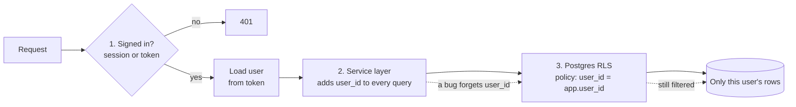

1. **Authentication** decides who is asking. The tenant always comes from the sign-in, never from
   the URL or the request body.
2. **The service layer** is the only code allowed to touch the database, and every per-user
   function takes a `Ctx` (current user, plan, scopes). Repository methods for per-user tables
   require `user_id` as an argument.
3. **Postgres RLS** on every per-user table:

```sql
ALTER TABLE user_jobs ENABLE ROW LEVEL SECURITY;
ALTER TABLE user_jobs FORCE ROW LEVEL SECURITY;
CREATE POLICY own_rows ON user_jobs
    USING (user_id = current_setting('app.user_id')::uuid)
    WITH CHECK (user_id = current_setting('app.user_id')::uuid);
```

Each request runs in a transaction that starts with `SET LOCAL app.user_id = '<uuid>'`. The app
connects as a role **without** `BYPASSRLS`. Catalog work (workers processing public jobs) uses a
separate role with access only to catalog tables. Admin tools use a third role, and every admin
read is written to `audit_log`.

**Tests** (see [22](#22-testing-strategy)): for every endpoint and page that takes an id, sign in
as user B and request user A's object: the answer must be `404`, never `403` (so ids can't be
probed) and never A's data.

---

## 10. Sign-in and access

### 10.1 Signing in on the site

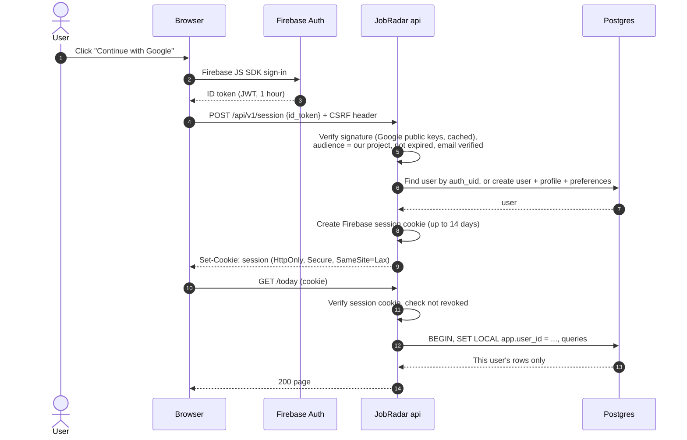

- First sign-in creates the user, an empty profile, default preferences and the free plan, then
  sends them to onboarding (import resume, set preferences, pick sources).
- Sign-out: `DELETE /api/v1/session` clears the cookie and revokes the Firebase refresh tokens.
- Admin can disable a user: Firebase account disabled + `users.deleted_at`; the next request
  fails.

### 10.2 Who can do what

| Caller | Proves identity with | Allowed |
|---|---|---|
| Signed-in user on the site | Session cookie + CSRF token on every form and POST | Everything for their own account |
| Their phone or another browser | Same, after signing in there | Same |
| Their script or app | `Authorization: Bearer <JobRadar API token>` (created on the site, shown once, stored as a hash) or a Firebase ID token | Their account, limited to the token's scopes (`read`, `write`) |
| Email action link | Signed single-use link with expiry | One action on one job |
| Admin (owner) | Firebase custom claim `role=admin`, plus a second factor | Users, plans, platform sources, support views; every action audited |
| Anyone | Nothing | `GET /api/v1/health`, the landing page, sign-in |

### 10.3 API tokens

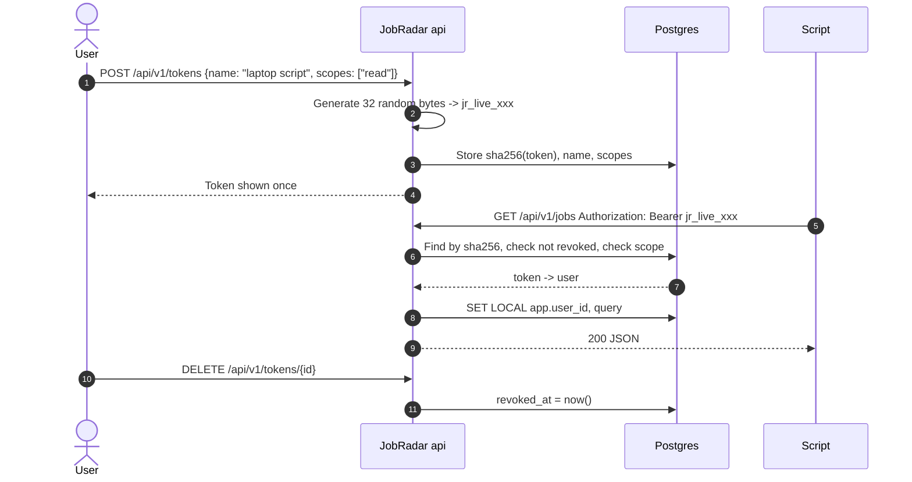

### 10.4 Email action links

Today the "I applied" button opens a pre-written email that the user sends to themselves, and
JobRadar reads it over IMAP. The SaaS can't read users' inboxes, so buttons become links:

`https://app.jobradar.example/a/<token>` where the token is an HMAC-signed
`{user_id, job_id, action, expires}` with a 7-day expiry and a single-use record. Opening it shows
a one-tap confirm page (so email scanners that pre-open links can't trigger actions), then
applies the action through the same status rules as the dashboard.

---

## 11. The job pipeline for many users

The pipeline splits into a **shared half** (once per posting) and a **per-user half** (once per
user the posting could fit).

```mermaid
flowchart LR
    subgraph Shared["Shared: once per posting (catalog)"]
        S1[Scheduler: board, page,<br/>channel is due] --> S2[Read source]
        S2 --> S3[Ingest: save raw message,<br/>clean links, dedupe]
        S3 --> S4[Fetch job page<br/>robots.txt, rate limits]
        S4 --> S5[Extract JobPosting<br/>rules first, LLM fallback,<br/>shared LLM cache]
        S5 --> S6[Ads, scams, still-open,<br/>catalog_status]
        S6 --> S7[Fan-out task]
    end
    subgraph Fan["Fan-out: which users could it fit?"]
        S7 --> F1[Hard-filter query:<br/>followed source, batch years,<br/>places / remote, branch]
        F1 --> F2[One MATCH task per<br/>candidate user]
    end
    subgraph PerUser["Per user"]
        F2 --> U1[Match vs that user's profile<br/>rules, then LLM if needed;<br/>counts against their quota]
        U1 --> U2[Decide: alert, inbox, hide<br/>user's own alert_above]
        U2 --> U3[user_jobs row + outbox event]
        U3 --> U4[Alert email, digest,<br/>auto resume if above threshold]
    end
```

**Fan-out in detail**

A new catalog job carries its sources, batch years, places, work mode and branch requirements
(extracted). The fan-out runs **one SQL query** against `preferences` and `user_sources` with
indexes, for example: users who follow at least one of the job's sources, whose batch years
overlap, whose places overlap or who accept remote, and who aren't excluded by branch rules.
Users who don't pass get **no row and no LLM call**.

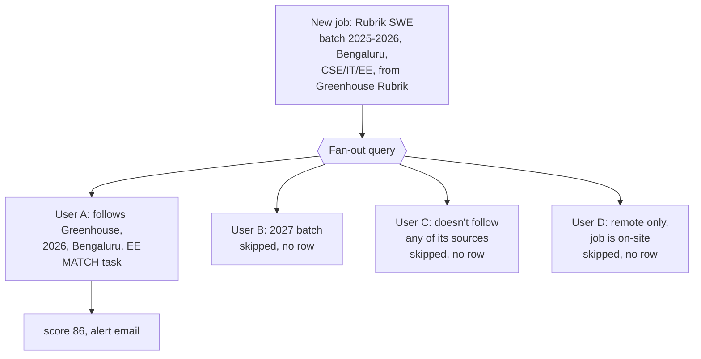

**Why this keeps costs flat:** with 1,000 new postings a day and 100,000 users, the naive way is
100 million match decisions a day. With extraction shared and hard filters first, each posting
reaches only the users it could fit (typically a few hundred), and the LLM is only used for those
whose rule-based score is borderline.

**Following sources:** by default a new user follows every public board and channel in the
catalog that matches their preferences (so they see jobs immediately); they can unfollow. A user
can suggest a new board or page (`POST /api/v1/sources/suggest`); the admin approves it into the
catalog so everyone benefits.

**Profile changes:** when a user edits their profile or preferences, a re-match task re-scores
their open `user_jobs` (and runs the fan-out query backwards over recent catalog jobs that now
fit), exactly like today's "profile change re-matches open jobs", limited by their quota.

---

## 12. Task queue and workers

Today's queue (table `task`, `claim()` with `UPDATE ... RETURNING`, retries with backoff,
priorities, stuck-task recovery) moves to Postgres with three changes:

1. **Safe parallel claims:** `SELECT ... FOR UPDATE SKIP LOCKED` so many workers never take the
   same task.
2. **`user_id` on tasks** (null for catalog work), so work can be shared fairly.
3. **Fair scheduling:** a worker picks the next task by round-robin across users who have ready
   tasks (plus catalog work at a fixed share), so one user's 50 resume builds can't make everyone
   else wait.

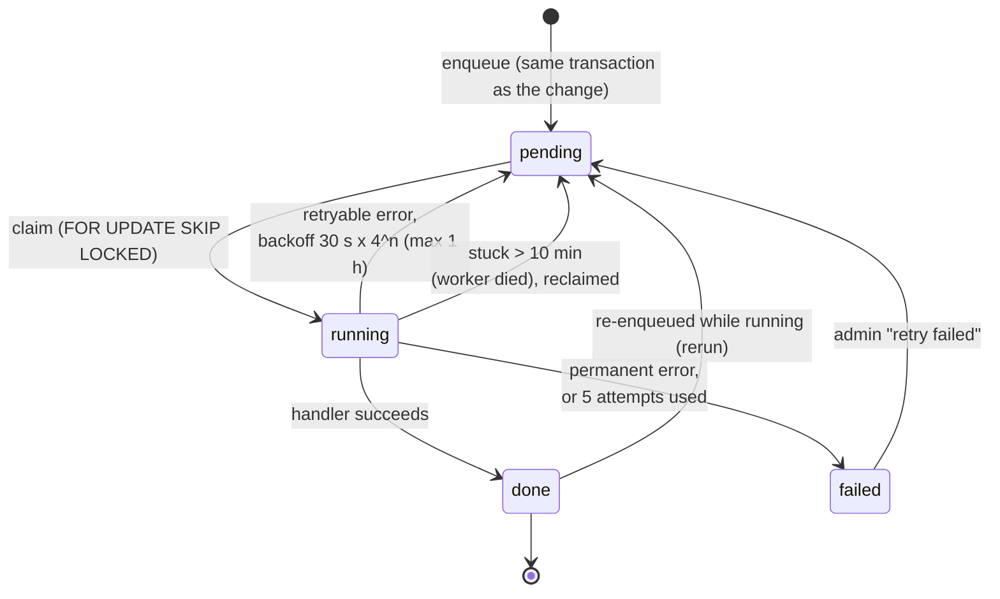

| Task type | Shared or per user | Notes |
|---|---|---|
| `boards_tick`, `board_check`, `pages_tick`, `page_check`, `freehire_check`, `channel_read` | Shared | Scheduler enqueues when due; one copy per source. |
| `process_message`, `fetch`, `extract` | Shared | Once per posting; LLM cache shared. |
| `fanout` | Shared | One per new or changed catalog job. |
| `match` | Per user | Quota: `llm_calls_per_day`. |
| `send_alerts`, `digest`, `closing_check`, `followup_check` | Per user | Email quota. |
| `build_resume` | Per user | Quota: `resume_builds_per_day`. |
| `rematch_profile` | Per user | After profile or preference edits. |
| `export_account`, `delete_account` | Per user | DPDP. |

---

## 13. Live updates (SSE)

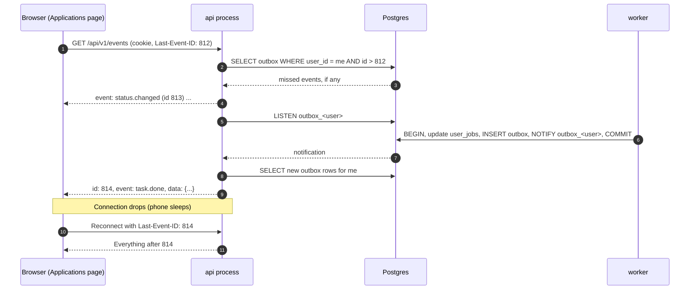

- Events are written to `outbox` **in the same transaction** as the change, so a client never
  hears about something that was rolled back, and nothing is lost on a crash.
- Postgres `LISTEN/NOTIFY` wakes the API instantly; the outbox table is the durable record.
- Old outbox rows are deleted after 7 days.
- A heartbeat comment every 25 seconds keeps proxies from closing idle streams.

| Event | When | What the page does |
|---|---|---|
| `job.matched` | A new job fits this user | Today list grows, count badge updates |
| `status.changed` | Any status change (site, email link, API) | Board moves the card on every open device |
| `task.done` / `task.failed` | Resume build, import, export finished | "Resume ready" toast, file appears |
| `quota.low` | 80 % of a daily quota used | Gentle notice |
| `source.health` | A followed source starts failing or recovers | Sources page badge |

---

## 14. The REST API

### 14.1 Endpoints

All under `/api/v1`. "My" data only: the user comes from the sign-in.

| Area | Method and path | What it does |
|---|---|---|
| Session | `POST /session` | Exchange a Firebase ID token for a session cookie |
| | `DELETE /session` | Sign out |
| Account | `GET /me` | Profile summary, plan, quotas left |
| | `POST /me/export` | Start an export of all my data (202) |
| | `DELETE /me` | Delete my account and data (202, confirmation required) |
| Profile | `GET /profile`, `PUT /profile` | Read or replace my profile (same shape as `profile.yaml`) |
| | `POST /profile/import` | Upload a resume (PDF or LaTeX) to draft my profile (202) |
| | `POST /profile/skills` | "I know this": add one skill |
| Preferences | `GET /preferences`, `PUT /preferences` | Batch years, places, remote, branch rule, alert score, digest times |
| Jobs | `GET /jobs` | List with `q, status, min_score, within, place, remote, source, sort, cursor, limit` |
| | `GET /jobs/{id}` | One job with my score, reasons, status, files |
| | `GET /jobs/{id}/history` | My status history for it |
| | `POST /jobs` | Add a job by link (202) |
| Status | `POST /jobs/{id}/actions` | Quick action, forward only: `shortlist, applied, skip, followed up, interview, offer, rejected` |
| | `PUT /jobs/{id}/status` | Set any of my statuses (fixing mistakes) |
| Applications | `GET /applications` | Board columns |
| | `GET /applications/by-source` | Applications and next rounds per source |
| Resumes | `GET /jobs/{id}/resumes` | My resumes and cover letters for a job |
| | `POST /jobs/{id}/resumes` | Build a new version (202) |
| | `GET /files/{id}` | Redirect to a short-lived signed R2 link |
| Search | `GET /search?q=` | Full-text search with highlighted snippets |
| Skills | `GET /skills?days=`, `GET /skills/{key}` | What my matches ask for; what exactly they want |
| Digest | `GET /digests`, `GET /digests/{window}` | My digests |
| Sources | `GET /sources` | Catalog sources, with whether I follow each, and health |
| | `POST /sources/{id}/follow`, `DELETE /sources/{id}/follow` | Follow or unfollow |
| | `POST /sources/suggest` | Suggest a board or page for the catalog |
| Follow-ups | `GET /followups`, `GET /jobs/{id}/followup-draft` | Due follow-ups and drafts |
| Tokens | `GET /tokens`, `POST /tokens`, `DELETE /tokens/{id}` | My API tokens |
| Tasks | `GET /tasks/{id}` | Progress of my background work |
| Events | `GET /events` | SSE stream of my events |
| Usage | `GET /usage` | Today's quota use |
| Admin | `GET /admin/users`, `PUT /admin/users/{id}/plan`, `GET /admin/sources`, `PUT /admin/sources/{id}`, `GET /admin/queue`, `GET /admin/usage` | Owner only, audited |
| System | `GET /health`, `GET /ready` | No sign-in; liveness and readiness |

### 14.2 Conventions

| Topic | Rule |
|---|---|
| Format | JSON, `snake_case`, UTF-8. Times in UTC ISO 8601 (`2026-10-24T09:12:04Z`). |
| Schemas | Pydantic models for every request and response; OpenAPI at `/api/v1/openapi.json`; docs page for signed-in users. |
| Lists | `{"items": [...], "next_cursor": "..."}`; cursor pagination, `limit` up to 100. |
| Errors | RFC 9457 problem details (`application/problem+json`) with `type`, `title`, `status`, `detail`. |
| Status codes | 200, 201 created, 202 accepted (task), 204 no content, 400 bad input, 401 not signed in, 403 wrong scope, 404 not found (also for other users' ids), 409 conflict (status can't move that way), 422 validation, 429 quota or rate limit (with `Retry-After`). |
| Long work | `202 Accepted` with `Location: /api/v1/tasks/{id}`; result also arrives as an SSE event. |
| Retries | `Idempotency-Key` header on every POST; the same key from the same user within 24 h returns the first response. |
| Rate limits | Per user and per token: requests per minute; daily quotas per plan (section 17). |
| CSRF | Cookie-authenticated POST/PUT/DELETE need the CSRF token; bearer tokens don't. |
| Versioning | `/api/v1` only grows. Removing or renaming a field means `/api/v2`, with v1 kept until clients move. |
| Contract test | A snapshot of `openapi.json` in the repo; CI fails on unreviewed changes. |

### 14.3 Examples

```http
GET /api/v1/jobs?status=new&min_score=75&limit=1
Cookie: session=...

HTTP/1.1 200 OK
Content-Type: application/json

{
  "items": [
    {
      "id": "1a2b3c4d",
      "role": "Software Engineer",
      "company": "Rubrik",
      "score": 86,
      "status": "new",
      "first_seen": "2026-10-23T09:12:04Z",
      "closes": "2026-10-30",
      "places": ["Bengaluru"],
      "work_mode": "onsite"
    }
  ],
  "next_cursor": "eyJzIjo4NiwiaWQiOiIxYTJiM2M0ZCJ9"
}
```

```http
POST /api/v1/jobs/1a2b3c4d/actions
Idempotency-Key: 6f1c...
Content-Type: application/json

{"action": "applied"}

HTTP/1.1 200 OK
{"id": "1a2b3c4d", "status": "applied", "before": "new", "message": "Marked as applied: Software Engineer @ Rubrik."}
```

```http
POST /api/v1/jobs/1a2b3c4d/resumes

HTTP/1.1 429 Too Many Requests
Content-Type: application/problem+json
Retry-After: 3600

{
  "type": "https://jobradar.example/errors/quota",
  "title": "Resume builds used up for today",
  "status": 429,
  "detail": "Your plan includes 5 builds a day. More open at 00:00 IST.",
  "quota": {"name": "resume_builds", "limit": 5, "used": 5}
}
```

### 14.4 A write, end to end

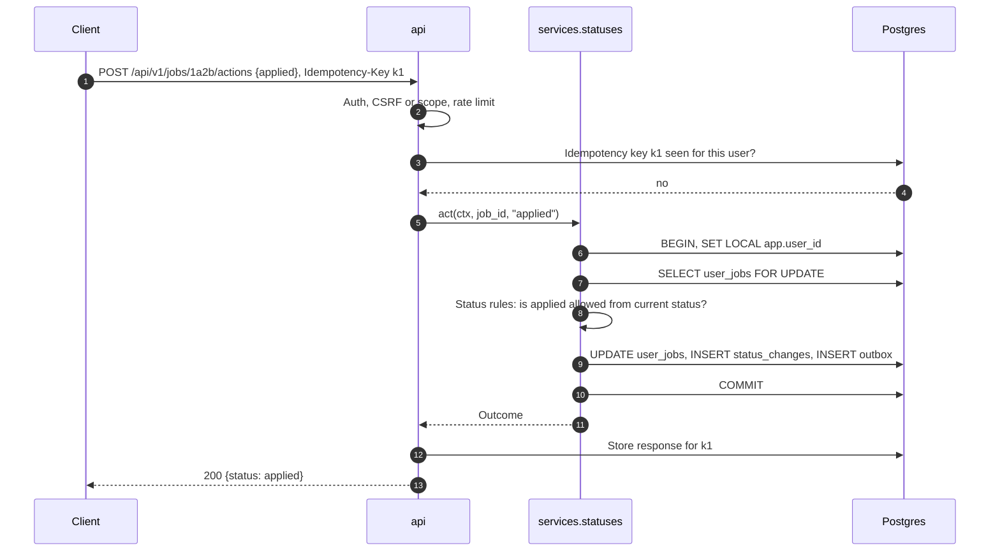

---

## 15. Pages (server-rendered)

The pages users already know stay, now per user, plus the pages a SaaS needs:

| Page | New or kept | Notes |
|---|---|---|
| Landing | New | What JobRadar does, sign-in button. Public. |
| Sign in | New | Firebase UI (Google, email link). |
| Onboarding | New | 1. Upload resume (or paste) to draft a profile; 2. check and fix it; 3. preferences; 4. sources to follow. |
| Today | Kept | My good matches from the last days. |
| Applications | Kept | My board, interviews by source. |
| All jobs | Kept | Search and filters over my matched jobs. |
| Job page | Kept | My score, reasons, status, resumes, follow-up draft. |
| Skills | Kept | From my matches. |
| Digest | Kept | My digests. |
| Profile | New (replaces editing `profile.yaml`) | Form editor for the same profile shape, plus "import from resume". |
| Settings | New | Preferences, email settings, timezone, API tokens, export, delete account. |
| Sources | New | Follow and unfollow catalog sources; suggest new ones. |
| Admin | New | Users, plans, catalog sources, queue, usage, audit. Owner only. |

All pages use the same CSP as today (`script-src 'self'`, no inline styles), plus the Firebase JS
SDK served from our own static files or its official CDN added to the CSP.

---

## 16. Email, files and resumes

### 16.1 Email

- Sent from our domain (for example `alerts@jobradar.example`) through Resend or SES, with
  SPF, DKIM and DMARC set up before the beta.
- Each user chooses: instant alerts on or off, digest times, follow-up reminders on or off.
- Every email has a one-click unsubscribe (RFC 8058 `List-Unsubscribe-Post`) and links to
  settings.
- Bounces and spam complaints switch that user's email off and show a notice on the site.
- Email quota per plan per day.

### 16.2 Files

- Resume PDFs and cover letters stored in R2 under `users/<user_id>/jobs/<job_id>/<version>/...`.
- The bucket is private. `GET /api/v1/files/{id}` checks ownership (RLS), then redirects to a
  signed link valid for 5 minutes.
- Deleting an account deletes the user's prefix.

### 16.3 Resumes

The resume rules stay exactly as on `main`:

- Facts come only from **that user's profile**: never invented skills, tools, numbers or claims.
  The grounding check stays code, never an LLM.
- One page, no em dashes, ATS check after compiling.
- Each user can choose a template (the classic layout to start) and mark profile items as
  "don't show on resume".

The LaTeX compile runs in a **separate locked-down container** (no network, read-only file
system, CPU and memory limits, time limit), because a user's profile text reaches the compiler
and LaTeX can run commands if misconfigured.

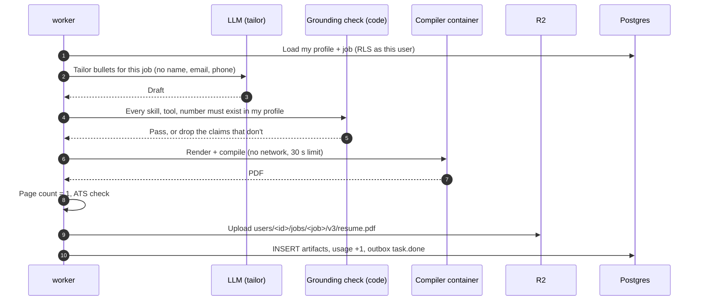

---

## 17. Plans, quotas and costs

Plans start simple and live in the `plans` table, so changing numbers needs no deploy.

| Limit per day | Free (beta) | Pro (after beta) |
|---|---|---|
| Matches with LLM help | 100 | 1,000 |
| Resume builds | 5 | 50 |
| Emails (alerts + digests + reminders) | 20 | 100 |
| Followed sources | 50 | Unlimited |
| API tokens | 2 | 10 |

The numbers above are starting guesses, to be tuned with real beta usage.

**Where money goes, and how we keep it small**

| Cost | How it grows | How we keep it down |
|---|---|---|
| LLM | Shared extraction: per posting. Matching and tailoring: per user | Rules before LLM; shared extraction cache; hard filters before matching; quotas; flash-lite models |
| Database | Rows in `user_jobs`, `status_changes` | Only rows for jobs that fit; indexes by `user_id`; old outbox and tasks pruned |
| Email | Per email sent | User settings; digest instead of many alerts; quotas |
| Files | Per resume | R2 (no download fees); old versions pruned after 90 days unless kept |
| Server | Per active user | One VM handles the beta; scale the `worker` first |

---

## 18. Security and privacy

**Threats and defences**

| Threat | Defence |
|---|---|
| One user reads another's data | Sign-in check, service layer adds `user_id`, Postgres RLS, isolation tests on every endpoint |
| Stolen session | HttpOnly, Secure, SameSite cookies; 14-day max; revocation on sign-out and on admin disable |
| CSRF | CSRF token on cookie-authenticated writes; SameSite=Lax |
| Stolen API token | Shown once, stored hashed, scoped, revocable, last-used shown |
| Email scanners clicking action links | Links open a confirm page; single use; 7-day expiry |
| A user makes the server fetch internal addresses (SSRF) via "add a link" or "suggest a source" | Existing private-address checks in the fetcher; outbound only through the worker; allow-list ports |
| LaTeX command execution | Compiler container without network, read-only, limits; `\write18` off |
| Prompt injection from job text | Job text passed as data, schema-validated outputs, no tools for the model (as today) |
| Abuse (bots, spam sign-ups) | Firebase abuse protection; email verification; rate limits; quotas |
| Leaked secrets | Secrets only in environment / secret manager; gitleaks in CI; user-provided keys encrypted with a server key (envelope encryption) |
| Lost data | Managed Postgres point-in-time restore + nightly dumps to R2; restore drill monthly |

**Privacy and India's DPDP Act**

- **Notice and consent** at sign-up: what we collect (profile, resume content, job activity), why,
  and with whom (LLM provider for job matching and tailoring, without name, email or phone).
- **Purpose limit:** profile data is used only for matching, resumes and the user's own emails.
- **Access and export:** `POST /me/export` produces a ZIP (profile, preferences, jobs, statuses,
  history, resumes) within minutes.
- **Correction:** profile and preferences are editable at any time.
- **Deletion:** `DELETE /me` soft-deletes at once (sign-in disabled, emails stop), hard-deletes rows
  and files after 30 days, and backups age out within the backup retention window.
- **Grievance contact** shown on the site.
- **No selling or sharing** of personal data; no ads.
- **Logs** never contain resume text, profile fields, tokens or emails.

---

## 19. Operations: hosting, backups, monitoring

### 19.1 Environments

| Environment | Database | Purpose |
|---|---|---|
| Local | Postgres in Docker Compose | Development; seeded with fake users and a copy of public catalog data |
| Staging | Small managed Postgres | Every merge to `saas/main` deploys here; migrations tested on a copy of production schema |
| Production | Managed Postgres (Mumbai region where possible) | Real users; deploys by tag |

### 19.2 Deployment

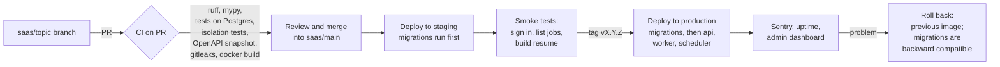

**Migration rule:** every Alembic migration must be **backward compatible for one release**
(add columns before using them, remove only after the code stopped using them), so a rollback
of the app image never breaks against the new schema.

### 19.3 Backups and restore

- Managed Postgres point-in-time restore (7+ days).
- Nightly `pg_dump` to R2, kept 30 days.
- R2 versioning on the files bucket.
- A restore drill every month into staging, written down in `docs/RUNBOOK.md` (created in the
  deploy PR).

### 19.4 Monitoring

| Signal | Where | Alert when |
|---|---|---|
| Errors | Sentry | New error type, or error rate spike |
| Uptime | Uptime check on `/api/v1/health` | Down 2 minutes |
| Queue | Admin page + metric | Pending tasks older than 15 minutes |
| Sources | Admin page | A popular board failing for 1 hour |
| LLM spend | Usage table | Daily spend above budget |
| Email | Provider dashboard | Bounce or complaint rate above provider limits |
| Database | Managed provider | CPU, storage, slow queries |

---

## 20. Moving the owner's existing data

The owner (user #1) has weeks of real history in `data/jobradar.db` (jobs, statuses, alerts,
resumes). PR 3 includes a one-time script:

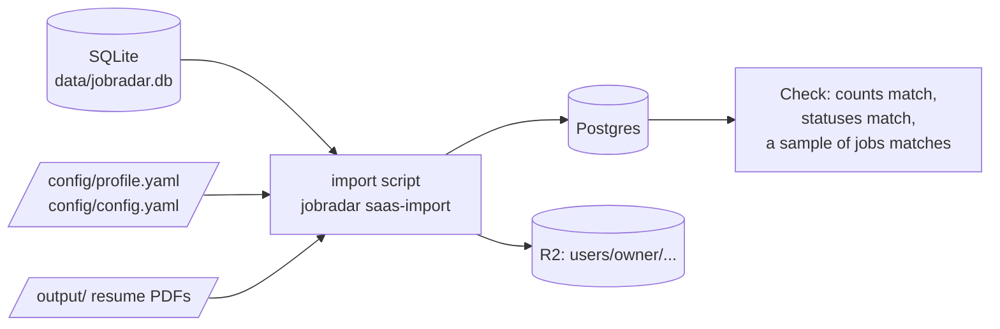

1. Catalog tables get the jobs, pages, sources and raw messages.
2. The owner's `users`, `profiles`, `preferences` rows come from the two YAML files.
3. `job.score/status/score_reason/user_status_at` become the owner's `user_jobs` rows; status
   history, alerts and artifacts get the owner's `user_id`.
4. PDFs upload to R2 under the owner's prefix.
5. A check compares counts and a sample, and the script can run again safely (idempotent).

The self-hosted SQLite file is never modified.

---

## 21. The pull requests, one by one

All PRs go **into `saas/main`**. Each one leaves the app working and the tests passing.

```mermaid
flowchart LR
    P0[0 saas/plan<br/>this document] --> P1[1 services-read]
    P1 --> P2[2 services-write]
    P2 --> P3[3 postgres]
    P3 --> P4[4 auth]
    P4 --> P5[5 user-scoping]
    P5 --> P6[6 api-read]
    P5 --> P7[7 catalog]
    P7 --> P8[8 fanout]
    P6 --> P9[9 api-write]
    P8 --> P9
    P9 --> P10[10 quotas-tokens]
    P10 --> P11[11 events]
    P10 --> P12[12 workers]
    P11 --> P13[13 email]
    P12 --> P13
    P13 --> P14[14 files]
    P14 --> P15[15 onboarding]
    P15 --> P16[16 deploy]
    P16 --> BETA((Private beta))
    BETA --> P17[17 billing]
```

### PR 0: `saas/plan` (this document)

- **What:** `SAASPLAN.md`, a pointer to it in `AGENTS.md` (on `saas/main` only).
- **Done when:** merged into `saas/main`.

### PR 1: `saas/services-read`

- **Why:** today the logic for pages lives in `web/views.py` (about 1,330 lines) and commands in
  `__main__.py` (about 970 lines). The API, pages and CLI must share one implementation, and every
  function must know which user it serves.
- **What:** create `jobradar/services/` with read services: `jobs` (list, detail, search),
  `applications` (board, by source), `skills`, `digest`, `stats`, `sources`. Each takes a `Ctx`
  (for now always the single owner). They return the existing typed dataclasses (`Card`,
  `Detail`, `SkillRow`, ...), which pydantic serializes as they are in PR 6, so no model is
  written twice. `web/views.py` is removed: the pages and the CLI read commands (`skills`,
  `sources`, `stats`) call the services. The full-text search module moves to
  `services/search.py`.
- **Tests:** the existing suite passes unchanged (pages render identically); new unit tests per
  service.
- **Done when:** no page or command reads the repository directly for these areas.

### PR 2: `saas/services-write`

- **What:** status actions and changes (`services/statuses.py`, used by the dashboard **and**
  the email buttons), resume requests, progress and builds (`resumes.py`), add a link
  (`intake.py`), "I know this" (`profile.py`), retry failed tasks (`tasks.py`), test alert,
  digest now and follow-ups (`notify.py`). Services raise `NotFound` / `Refused`
  (`errors.py`); the web turns them into 404 / 409, the CLI into an error line. `Ctx` gains the
  app's queue and `today`.
- **Moved to PR 7:** adding and removing boards and pages. Today they edit `config.yaml`; in the
  SaaS they become catalog rows, so they are rewritten there instead of moved twice.
- **Tests:** existing tests; new service tests for every status rule.
- **Done when:** the web app and CLI contain no business rules, only input/output.

### PR 3: `saas/postgres`

- **Why:** see [7.1](#71-database-one-shared-postgres-database) and
  [7.2](#72-postgres-from-the-first-data-pr-not-later).
- **What:**
  - Postgres in `docker-compose.yml` for local work; `DATABASE_URL` setting.
  - Alembic, with a first migration that creates today's schema in Postgres types
    (`timestamptz`, `jsonb`, `tsvector`).
  - Port the 36 SQLite-specific spots in `db/repo.py` (`PRAGMA`, `INSERT OR IGNORE` →
    `ON CONFLICT`, FTS5 → `tsvector` + `ts_headline`, `RETURNING` and claim → `SKIP LOCKED`).
  - CI runs the tests against a real Postgres service.
  - `jobradar saas-import`: the owner's SQLite data into Postgres (section 20).
- **Done when:** the whole app runs on Postgres with the owner's data, single user still.
- **As built (2026-10-24):**
  - `DATABASE_URL` in `.env` switches to Postgres (`db/repo.connect`); unset, it's SQLite as before.
  - `pyproject` extra `postgres` (psycopg 3, Alembic); migrations in `src/jobradar/db/migrations/`
    (`0001`: today's 14 tables plus `job_search`), run by `init_db` on start.
  - The SQL in `repo.py` is portable where it can be (`IS DISTINCT FROM`, `TRUE/FALSE`, `CASE`
    instead of `max(a, b)`, `NULLS LAST`, qualified upsert columns, typed `NULL` parameters) and
    branches only where it must (`group_concat`/`string_agg`, minutes between times, the task claim
    with `FOR UPDATE SKIP LOCKED`, and search).
  - Search: `db/textsearch.TextQuery` compiles to FTS5 on SQLite and to `tsquery` on Postgres
    (`job_search` with weighted generated `tsvector` columns, GIN indexes, `ts_rank`,
    `ts_headline`).
  - **Deliberately kept for PR 5:** times stay ISO text and JSON stays text, so values and
    comparisons are identical on both databases while the code is shared; PR 5 converts them to
    `timestamptz`/`jsonb` together with the `job` → `jobs` + `user_jobs` split.
  - **Both databases are tested:** the suite runs on SQLite by default and, with
    `JOBRADAR_TEST_DATABASE_URL`, on Postgres (CI job `postgres`), including a check that the
    migrations match the models and that two workers never claim the same task.
  - `jobradar saas-import`: copies `data/jobradar.db` (opened read-only) into `DATABASE_URL`,
    resets id counters, builds the search index and checks row counts; safe to run again.
  - `docker compose --profile postgres up -d` starts a local Postgres on 127.0.0.1:55432.

### PR 4: `saas/auth`

- **What:** Firebase project setup (documented), `saas/auth.py` (verify ID tokens, session
  cookies, revocation), `POST/DELETE /api/v1/session`, sign-in page, CSRF tokens, `users` and
  `plans` tables, admin claim. The 127.0.0.1 page token is replaced by sessions.
- **Tests:** token verification with test keys; expired, wrong audience, revoked; CSRF required.
- **Done when:** the site needs sign-in, and the owner signs in with Google.
- **As built (2026-10-25):**
  - `AUTH_ENABLED` in `.env` turns sign-in on; off, the dashboard is the local one with the page
    token, as on `main`. All sign-in settings are in `.env` (`FIREBASE_API_KEY`,
    `FIREBASE_AUTH_DOMAIN`, `FIREBASE_PROJECT_ID`, `AUTH_WAYS`, `AUTH_SESSION_DAYS`,
    `FIREBASE_CREDENTIALS`, `JOBRADAR_ADMIN_EMAIL`), never `config.yaml`, which both branches
    share: `main` refuses settings it doesn't know. Extra `saas` (`firebase-admin`).
  - **Three ways to sign in** (owner's choice): Google, email and password (with verification and
    reset emails), and phone (SMS code, invisible reCAPTCHA). The page uses the Firebase JS SDK
    from gstatic with in-memory persistence; its own CSP allows only Firebase, Google's sign-in
    APIs and reCAPTCHA. No inline scripts or styles.
  - `saas/auth.py`: the only Firebase code, behind an `Auth` protocol. ID tokens must be from the
    last 5 minutes; session cookies are checked locally and against Firebase for sign-outs and
    switched-off accounts at most every 5 minutes per session; refuses to start if
    `FIREBASE_AUTH_EMULATOR_HOST` is set (the library skips signature checks then).
  - `web/signin.py`: `GET /signin`, `POST /api/v1/session` (double-submit CSRF cookie + Origin
    check), `DELETE /api/v1/session` and `POST /signout` (revoke everywhere), `GET
    /api/v1/health`, and the check every request passes. Form tokens are an HMAC of the session
    cookie, so they change with each sign-in.
  - `users` (with `phone` and `last_seen_at` beyond section 8) and `plans` (section 17 numbers,
    plus `api_tokens_max`); migration `0002`; plan rows added by `init_db`. First sign-in creates
    the user on the free plan; a verified `JOBRADAR_ADMIN_EMAIL` gets `role = admin` and the
    Firebase claim.
  - **Until PR 5, only the admin opens the dashboard** (it still shows the owner's data); anyone
    else gets an account and a "You're on the list" page. The admin's second factor (section
    10.2) is left for PR 16, before the site is public.

### PR 5: `saas/user-scoping`

- **Why:** the biggest change. Every per-user fact gets a `user_id`.
- **What:**
  - Split `job` into catalog `jobs` and per-user `user_jobs` (score, status, reasons, decision).
  - `user_id` on `status_changes`, `alerts`, `artifacts`, `tasks`, follow-up settings, and the
    new `profiles`, `preferences`, `user_sources`.
  - Profile and config move from YAML files to `profiles` and `preferences`.
  - RLS policies on every per-user table; database roles (`app`, `catalog_worker`, `admin`).
  - `SET LOCAL app.user_id` per request and per task.
- **Tests:** the isolation suite: two users, every page and endpoint, B can't see A's anything.
- **Done when:** two test users have fully separate dashboards.
- **Split into four PRs** (2026-10-25), each reviewable on its own and leaving the app working:
  - **5a `saas/user-jobs`:** `job` → catalog + `user_jobs`; the repo scoped to a user.
  - **5b `saas/user-rows`:** `user_id` on status history, alerts, artifacts, tasks, follow-ups.
  - **5c `saas/profiles`:** profile and preferences from YAML into `profiles` / `preferences`.
  - **5d `saas/rls`:** RLS policies, database roles, `SET LOCAL app.user_id`, the isolation suite;
    the dashboard opens to every signed-in user. Times and JSON become `timestamptz` / `jsonb`
    here too.
- **As built, 5a (2026-10-25):**
  - The catalog table keeps its name, `job` (renaming it would touch every query for no gain);
    its `status` is now only where the pipeline is (`discovered`, `extracted`, `needs_review`,
    `discarded`), with `status_reason`. `user_jobs` holds score, reason, status (`new` …
    `skipped`, or NULL: not matched yet), `user_status_at` and the Notion page, keyed by
    `(user_id, job_id)` with indexes starting at `user_id`.
  - `models.Job` is no longer a table: it is the job as one user sees it, built by `JOB_VIEW` in
    `repo.py` (the posting LEFT JOIN that user's row), so cards, pages, emails and the pipeline
    read it unchanged. A catalog step (re-read, re-extract) puts the job back in the pipeline for
    every user who hasn't set its status themselves, as before.
  - `Repo.for_user(id)` scopes every per-user query; `Ctx` always hands services a repo scoped to
    its `user_id`, and the dashboard's `Ctx` comes from the signed-in user. The pipeline still
    works for the owner (fan-out per user is PR 8).
  - The owner is a real `users` row (`id = 'owner'`); the admin's first sign-in takes it over,
    keeping every existing score and status. Migration `0003` moves Postgres data;
    `init_db` does the same once for an old SQLite file; `saas-import` splits old rows as it
    copies. Checked on a copy of the owner's data: all 1,265 jobs read back identically.
  - Fixed: a CLI test (`alerts --test`) opened `data/jobradar.db` in the repo; tests now always
    get a throwaway default database.
- **As built, 5b (2026-10-25):**
  - `user_id` (required, foreign key to `users`) on `status_change`, `alert` (key now
    `(user_id, job_id)`: one alert per job and user) and `artifact`; indexes start at `user_id`.
    Every query on them is for the repo's user; someone else's resume reads as not found.
  - One user's per-job notes (`followed_up:`, `company_replied:`, `closing_reminder:`,
    `followup_reminder:`, `skill_gaps_week`) move from `setting` to `user_settings`
    (`get_user_setting` / `set_user_setting`); `setting` keeps the app's own state.
  - Migration `0004` moves Postgres rows to the owner; an older SQLite file is repaired once on
    start; `saas-import` moves the notes as it copies. Checked on a copy of the owner's data:
    107 status changes, 392 alerts and the notes carry over, every status unchanged.
  - **Moved to PR 8:** `task.user_id`. Every task still works for the owner; which tasks are
    per user (match, alert, resume) is decided with the fan-out there.

### PR 6: `saas/api-read`

- **What:** every `GET` in [14.1](#141-endpoints), problem errors, cursors, OpenAPI with a
  snapshot test, docs page for signed-in users.
- **Done when:** a script with a session can read everything the pages show.

### PR 7: `saas/catalog`

- **What:** catalog tables shared by all users; the platform Telegram account for public
  channels; sources table with an admin approval flow; shared extraction cache.
- **Done when:** jobs are read and extracted once, with no user involved.

### PR 8: `saas/fanout`

- **What:** the fan-out query and indexes; `match` tasks per candidate user; re-match on profile
  or preference change; follow/unfollow sources.
- **Tests:** users with different batches, places and sources get exactly the jobs they should.
- **Done when:** one new job reaches only the users it could fit.

### PR 9: `saas/api-write`

- **What:** every write in [14.1](#141-endpoints): actions, status, resumes (202), add a link,
  profile, preferences, follow, suggest, skills; `Idempotency-Key`.
- **Done when:** the pages' buttons and the API share one code path for every change.

### PR 10: `saas/quotas-tokens`

- **What:** API tokens (create, list, revoke, scopes); `usage_daily`; quota checks in services;
  rate limits per user and token; `429` with `Retry-After`; settings page for tokens and usage.
- **Done when:** a user who hits a limit gets a clear message and nothing more is spent.

### PR 11: `saas/events`

- **What:** `outbox` + `LISTEN/NOTIFY`; `GET /api/v1/events` (SSE, `Last-Event-ID`, heartbeat);
  pages update live (Today, Applications, job page, resume ready).
- **Done when:** a status change on the phone moves the card on the laptop within a second.

### PR 12: `saas/workers`

- **What:** separate `api`, `worker`, `scheduler` processes and Compose services; fair claiming
  across users; scheduler lock; health and readiness endpoints.
- **Done when:** a heavy user doesn't slow others (load test in the PR).

### PR 13: `saas/email`

- **What:** email provider integration; sender domain setup docs; signed action links and the
  confirm page; unsubscribe; bounce and complaint handling; per-user email settings.
- **Done when:** alerts and digests reach a test Gmail and Outlook inbox, not spam.

### PR 14: `saas/files`

- **What:** R2 storage for artifacts; signed download links; the locked-down compiler container;
  pruning old versions.
- **Done when:** resumes build and download for two users without either seeing the other's.

### PR 15: `saas/onboarding`

- **What:** landing page, onboarding steps (resume import to draft profile, review, preferences,
  sources), profile editor, settings, export and delete account, privacy notice and consent.
- **Done when:** a new person goes from landing page to first matches in under 5 minutes.

### PR 16: `saas/deploy`

- **What:** production Compose file, Caddy, managed Postgres, R2 buckets, secrets handling,
  staging environment, CI deploy workflow, Sentry, uptime checks, backups and a restore drill,
  `docs/RUNBOOK.md`.
- **Done when:** staging and production run, a restore was practised, and 20 to 50 beta users
  are invited.

### PR 17: `saas/billing` (after the beta)

- **What:** Razorpay subscriptions (UPI, cards), plan changes, invoices, webhooks, grace periods.
- **Done when:** a user can upgrade and the higher quotas apply at once.

---

## 22. Testing strategy

| Kind | What it covers | Where |
|---|---|---|
| Unit | Services, status rules, scoring, fan-out filters, quota math | pytest, fast, no network |
| Database | Repository and migrations against real Postgres | pytest with a Postgres service in CI |
| Isolation | For each id-taking page and endpoint: user B asking for user A's object gets 404 | A generated test per route, so new routes are covered automatically |
| Contract | `openapi.json` snapshot; every response validates against its schema | CI |
| Auth | Token verification (valid, expired, wrong audience, revoked), CSRF, scopes | pytest with test keys |
| End-to-end | Sign in (Firebase emulator), onboard, get a match, build a resume, change status | Playwright against staging |
| Load | Fan-out with 10,000 fake users; 200 concurrent SSE streams; one user with 100 resume builds | Before the beta |
| Restore | Restore yesterday's backup into staging and run smoke tests | Monthly |

Existing tests from `main` keep running; tests that assumed a single user get a fixture user.

---

## 23. Risks and how we handle them

| Risk | Likelihood | Impact | Plan |
|---|---|---|---|
| Weekly merges from `main` conflict in `db/repo.py` | High | Medium | Keep SQL portable where possible; small weekly merges, never big ones |
| A query forgets `user_id` | Medium | High | RLS as a second lock; isolation tests per route |
| LLM costs grow faster than expected | Medium | High | Quotas, shared extraction, rule-first matching, spend alert |
| Job sites block a busy shared fetcher | Medium | Medium | Same politeness as today (robots.txt, per-site pace), shared fetch means fewer requests than per-user would |
| Email lands in spam | Medium | High | Proper domain setup, provider reputation, digests over many alerts, unsubscribe |
| Telegram account limits or bans | Medium | Medium | Read only public channels, respect flood waits, backup account, boards as the main source |
| Firebase outage | Low | Medium | Existing sessions keep working (cookies verified locally); only new sign-ins wait |
| Data protection complaint | Low | High | DPDP features from day one, clear notice, quick deletion |
| Owner's time (one developer, part-time) | High | Medium | Small PRs, each useful alone; the plan is ordered so the beta needs only PRs 0 to 16 |

---

## 24. Open questions

To decide before or during the named PR. Record answers here.

1. **Product name and domain for the SaaS** (needed by PR 13 for email and PR 16 for hosting).
2. **Managed Postgres provider**: Neon or Supabase for the beta (PR 3 works with either;
   decide by PR 16).
3. **Email provider**: Resend (simpler) or SES (cheaper at volume) (PR 13).
4. **VM provider**: Hetzner, DigitalOcean, Lightsail, or Fly.io (PR 16).
5. **Free plan limits** (section 17): confirm the starting numbers (PR 10).
6. **Public Telegram channel list** for the catalog (PR 7).
7. **Resume import**: which parser for uploaded PDFs, and how much the user must confirm (PR 15).
8. **Open-source status of the SaaS branch**: public on GitHub (MIT like `main`) or private (decide
   before PR 4, since it will contain deployment config).

---

## 25. Rules for anyone working on this branch

1. **Branching:** work on `saas/<topic>`, open the PR **into `saas/main`**. Never open SaaS PRs
   into `main`, and never merge `saas/main` into `main`.
2. **Sync:** merge `main` into `saas/main` weekly in a `saas/sync-<date>` PR.
3. **Data access:** only `services/` reads or writes data; per-user functions take a `Ctx`; every
   per-user table has `user_id` and an RLS policy in the same migration that creates it.
4. **Migrations:** Alembic only; backward compatible for one release.
5. **Isolation tests:** every new route that takes an id gets covered by the isolation suite.
6. **Privacy:** no personal data in logs; LLM calls never include name, email or phone.
7. **Resume rules:** facts only from the user's own profile; grounding check stays code.
8. **Quotas:** any new feature that spends money (LLM, email, storage) counts against a quota.
9. **Docs:** update this plan in the same PR when a decision changes; update `CHANGELOG.md` on
   `saas/main` under a `SaaS` heading.
10. **Commits:** no `Co-Authored-By` lines; PR body says what changed for users, what was tested.
11. **Conventions:** everything in `AGENTS.md` (code style, writing style, safety) applies here too.
